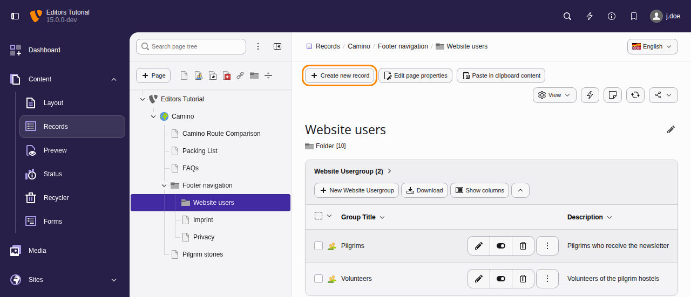
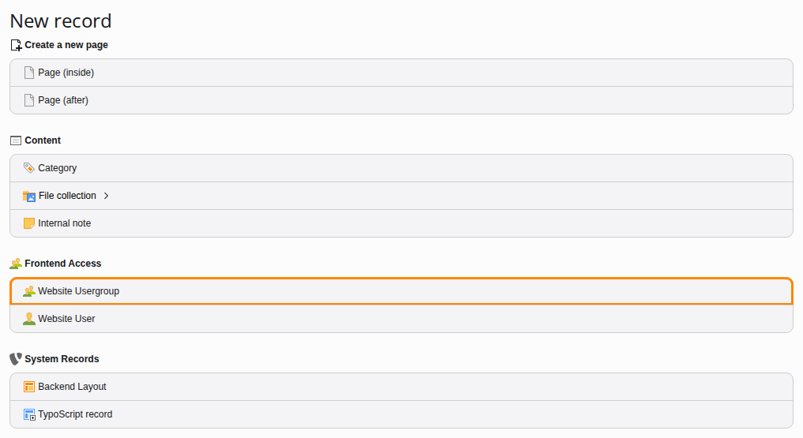
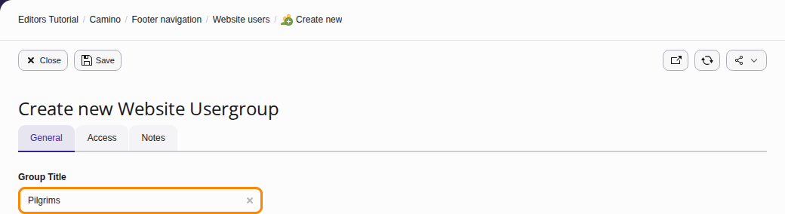
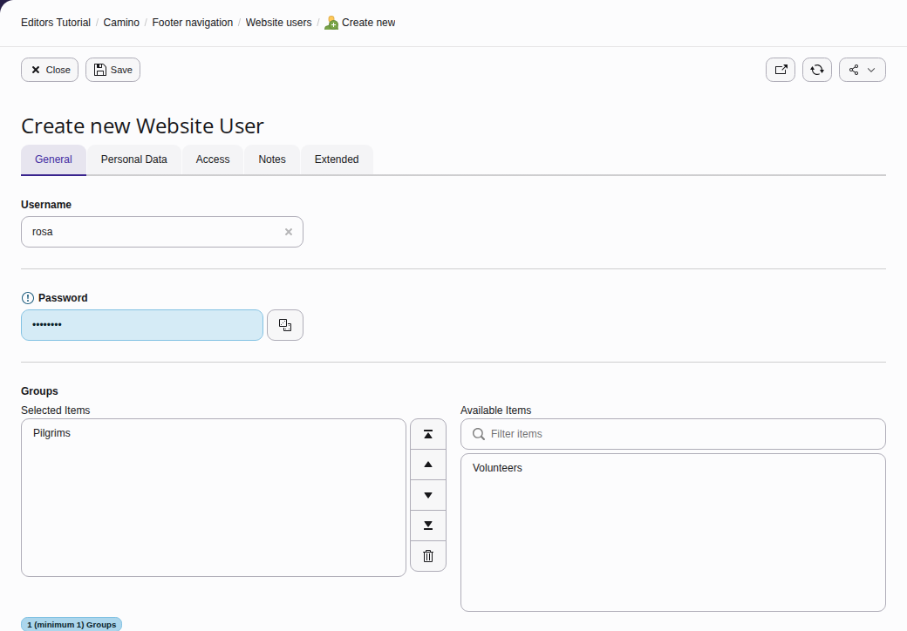
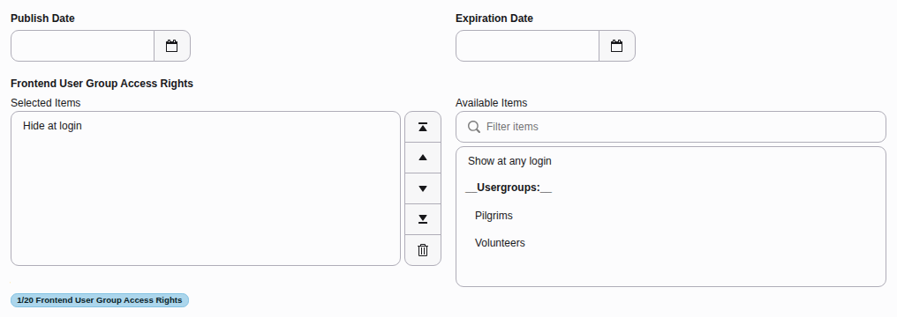
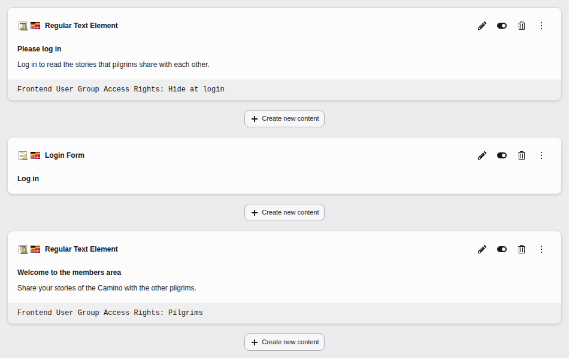
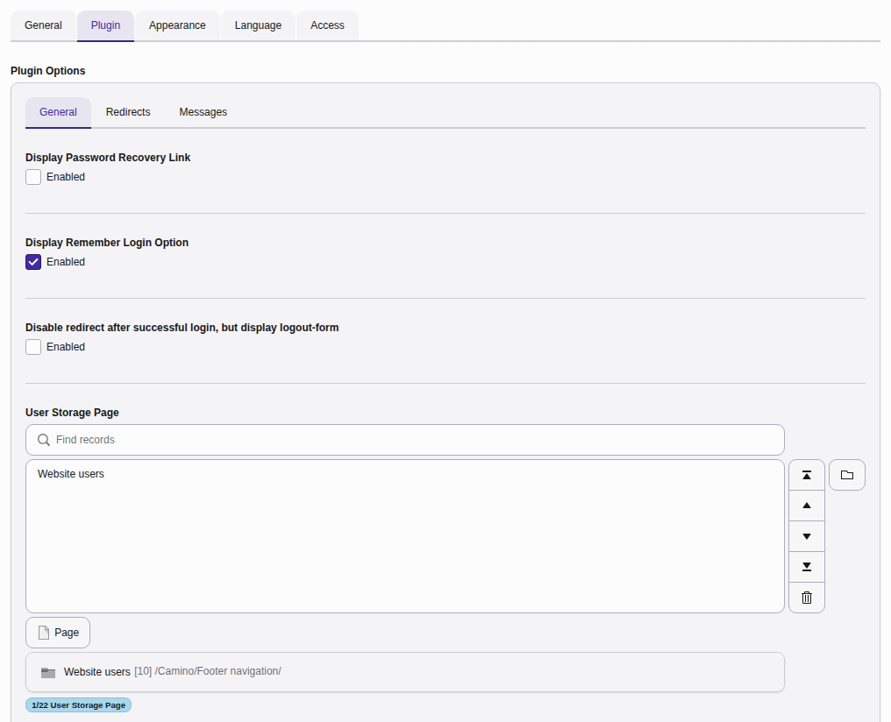
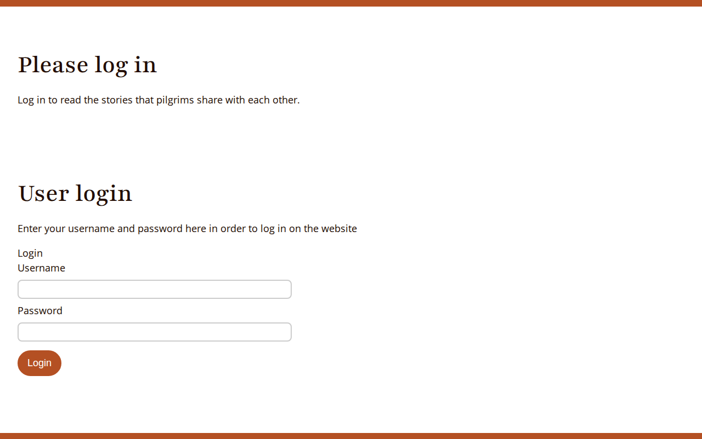
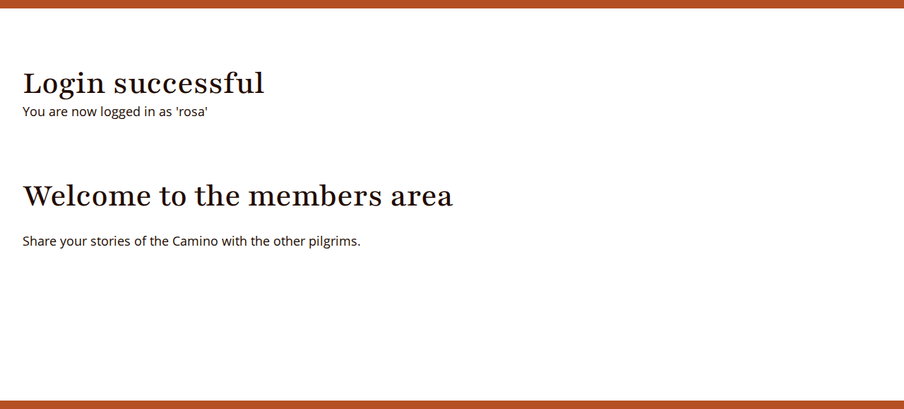

# Frontend login {#frontend-login}

You can configure content or pages to only be visible to frontend users who
have logged in.

## Frontend users {#frontend-login-users}

The concept of the TYPO3 [backend and frontend](https://docs.typo3.org/m/typo3/tutorial-getting-started/main/en-us/Concepts/Index.html#concepts) is explained in the Getting Started Tutorial.

You can use the concept of frontend users (website visitors) to create member-only content and restrict access to pages and content elements by requiring a
log in.

Frontend users are always part of frontend groups. Access is granted to
groups, never directly to users. Users and groups are defined like any other
record, and stored in a suitable page in the backend.

## Create a user group and user {#create-a-usergroup}

1.  Create a new folder in the page tree, and name it "Website users".

    
1.  Navigate to the **Content > Records** module, and select your new folder.
1.  Click **\+ Create new record** at the top left of the module. The
    "New record" wizard displays.

    
1.  Click **Website Usergroup** to create a new frontend group.
1.  Name it "Pilgrims".

    
1.  Save and close the record.
1.  Use the "New record" wizard again, but this time create a **Website User**.
1.  Type a username, a password and click the "Pilgrims" group to select it.

    

    You can add further information on the **Personal Data** tab if required.
1.  Save and close the record.

## Assign access rights {#frontend-login-rights}

Now that we have at least one group, and a user assigned to that group, we can
assign access restrictions. This is done on the **Access** tab of
the page properties or content element properties.

> [!NOTE]
> Two default groups appear in the list of groups. They are always available
> and cannot be edited or removed.
>
> -   The "Hide at login" group means that the element is only visible
>     when the user is not authenticated.
> -   The "Show at any login" group is used for elements that require
>     authentication to access, but are okay for all groups to see.

1.  Navigate to the **Content > Layout** module, and create a new page called
    "Members only".
1.  Add a text content element to the Members only page, with text similar to
    "Log in to read the stories that pilgrims share with each other".
1.  On the **Access** tab, select the "Hide at login" group for it.
1.  Save and close the record.
1.  Add another text content element to the page, with text similar to
    "Welcome to the members area".
1.  On the **Access** tab, select the "Pilgrims" group for it.
1.  Save and close the record.

You should have something like this:

Try setting the access for an entire page to "Pilgrims". When you save the
page, notice how the icon in the page tree changes. This is a visual reminder
that the page is not public. If you try to access a restricted page in the
frontend, the TYPO3 error message "Page Not Found" will display.

## Add a login form {#frontend-login-form}

The next step is to place a login box somewhere on the site so that visitors
can log in to view the restricted content.

1.  On the "Members only" page, click the **\+ Create new content**
    button between the two existing content elements.
1.  In the new content element wizard, go to the **Form elements** tab and
    select "Login Form".
1.  Give it a header (for example, *Log in*).
1.  Go to the **Plugin** tab. There are several options for the Login Form, but
    the only one which is absolutely necessary is the "User Storage Page".
1.  Use the **Browse for records** icon to browse the page tree and
    select the "Website users" folder.

    
1.  Save and close the record.
1.  View the page. You should have something like this:

    
1.  Enter the user name and the password you defined earlier for the
    frontend user, and you should see the following:

    

This is just a quick overview of the login form provided by TYPO3 CMS. It has a
rich set of features that are described in the [Frontend Login](https://docs.typo3.org/c/typo3/cms-felogin/main/en-us/Index.html) manual.
