

# Creating a contact form {#template-form}

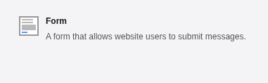

You can create a form from the **Content > Forms** module. This is a
system extension which needs to be activated by your administrator. It is
written in TypoScript and is fully documented in the [Form Framework](https://docs.typo3.org/c/typo3/cms-form/main/en-us/Index.html) system extension manual.

This module provides a guided interface for editors to create any kind of form
such as a contact form, newsletter subscription or a survey. TYPO3 comes
with one pre-defined form already built, which you can use to get started.

1.  In the **Content > Forms** module, click the **\+ Create new
    form** button. The **Create new form** wizard displays.

    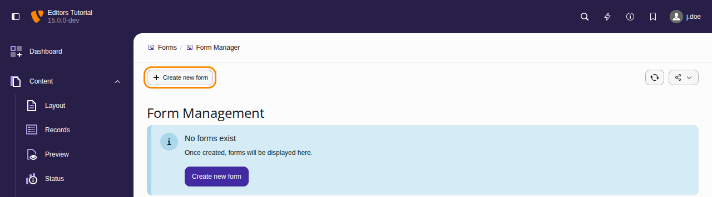
1.  Choose the template **Simple contact form**.

    <!-- TODO: no Markdown rendering for "versionchanged" -->

    Before, the wizard asked whether to create a blank form or a
    predefined form, and offered the templates in a list in a later
    step.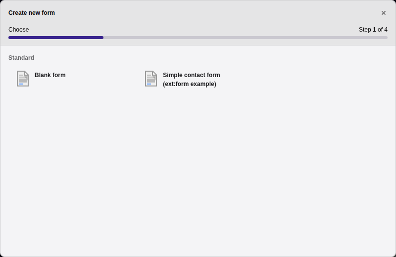
1.  Enter a name for the form and click **Next**.

    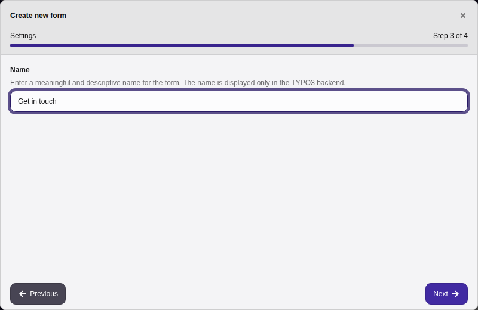
1.  TYPO3 creates the form. Click **Finish**. Your new form is
    displayed.

    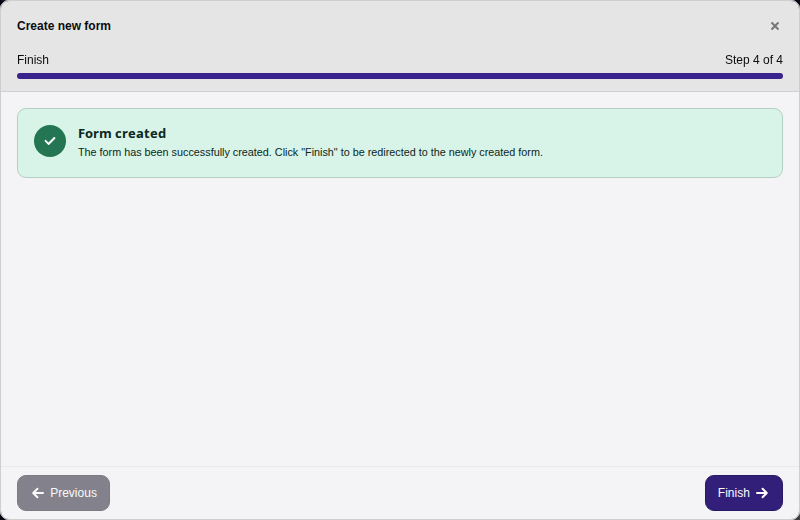

    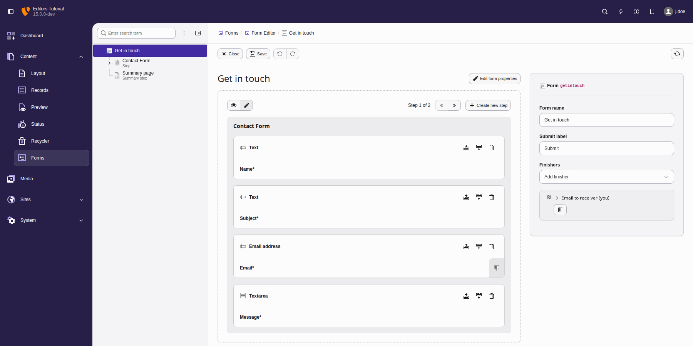

    The predefined 'Simple contact form' comes with some settings already
    configured, but you can edit these settings and add more fields. For
    example, you might want to delete the Summary page, and change
    the labels on the buttons.
1.  Add your form to a page the same way you would add any
    [content element](https://docs.typo3.org/permalink/t3editors:content-form@main). On the  **Form elements** tab, choose 'Form'.
1.  In the form content element, go to the **Plugin** tab and in the
    **Form definition** list, choose your form.

    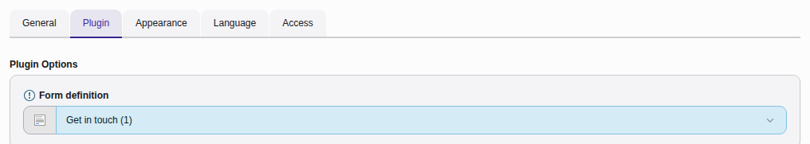
1.  On the **General** tab, type a header for your form, then save and close
    the record.

    Preview the page and it should look something like this:

    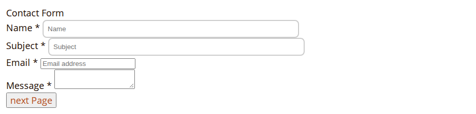

## Create a form from scratch {#create-form-scratch}

1.  In the **Content > Forms** module, click the **\+ Create new
    form** button.
1.  In the **Create new form** wizard, choose **Blank form**.
1.  Give your form a name, then click **Next** and **Finish**.

    A blank form displays.

    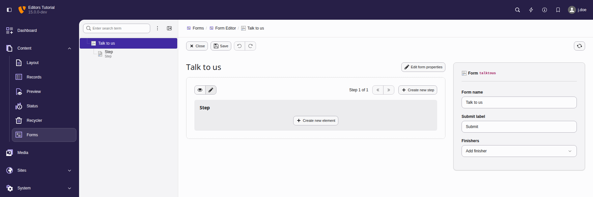
1.  Click the **Create new element** button. The **New element**
    window displays.

    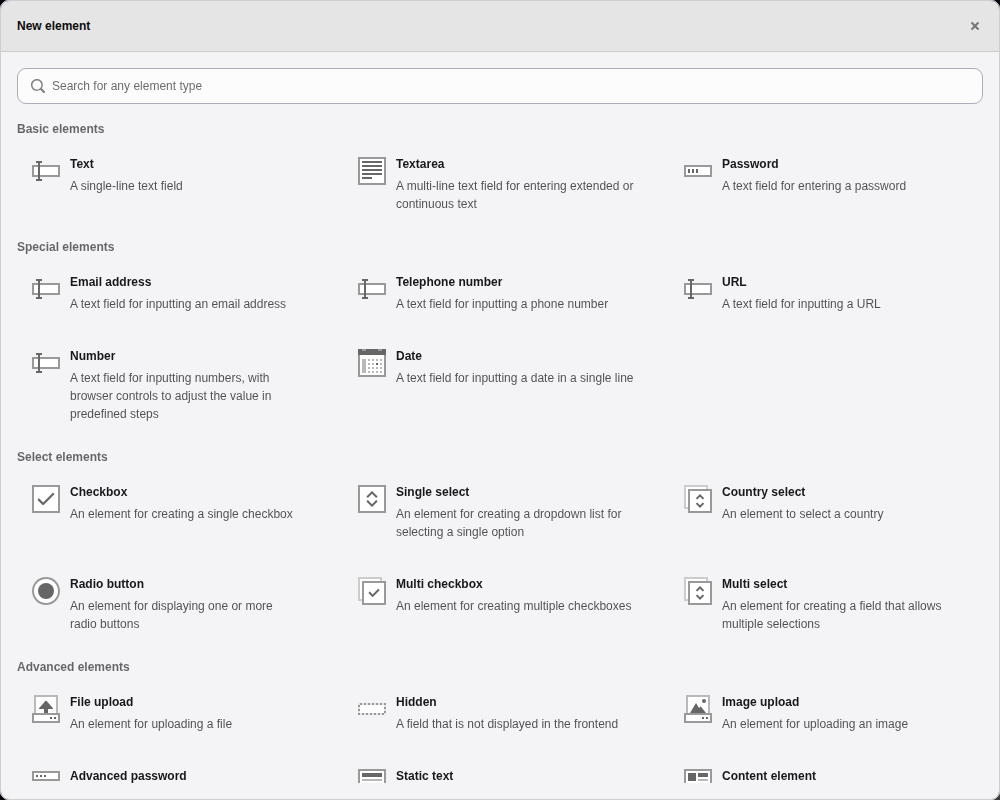

    TYPO3 comes with over twenty form fields by default, including:

    -   **Basic elements** like text or password fields
    -   **Special elements** requiring specific format validation, like phone
        numbers or dates
    -   **Select elements** like checkboxes or multiple choice
    -   **Advanced elements** that have special rules, like user uploads or
        calendar date pickers
    -   **Container elements** to visually organize surveys

    Once you’ve selected a form element, you can customize the settings for how the field is displayed.
1.  Choose the **Text** element and the field is added to your form. You can
    configure settings for the field (such as placeholder text and field
    validation) on the right-hand side of the screen .

    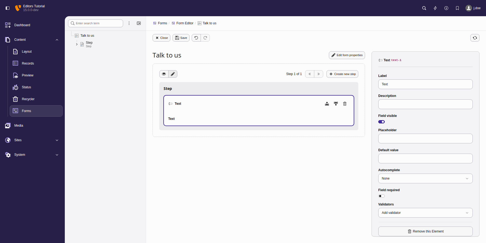
1.  Click the **Preview mode** icon to see an indication of how your
    form will display on the frontend. Use the **Edit mode** icon to
    return to editing your form.

    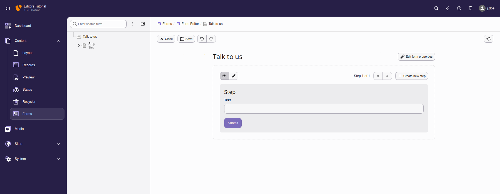

## Working with forms {#working-with-forms}

When you have added multiple fields to your form, you can drag and drop them
to rearrange their order.

Add **Finishers** like a confirmation message or redirection to another page.

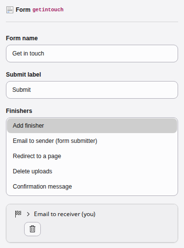

You can integrate extensions with existing forms. For example, if you're
running a sales operation, you can integrate with Mautic and any changes to a
TYPO3 form will update Mautic to give you seamless lead tracking.

> [!TIP]
> There are many more properties that can be defined. They are
> described in the ["Form Framework"](https://docs.typo3.org/c/typo3/cms-form/main/en-us/Index.html) system extension
> manual.
