# Managing content {#content-working}

[Watch this video on YouTube](https://www.youtube.com/watch?v=b-USBqOPD3c)

---

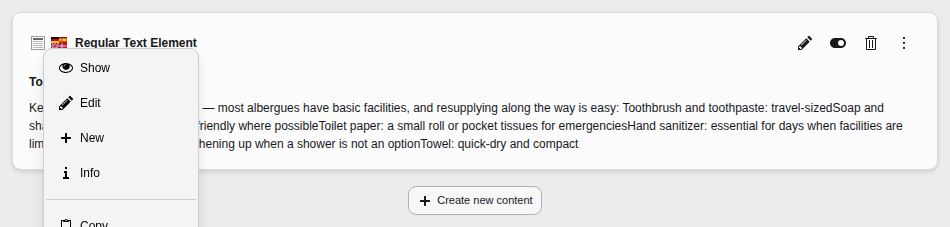

<!-- TODO: no Markdown rendering for "versionchanged" -->

The main module Web has been renamed to Content.

In TYPO3, working with content happens mostly in the **Content > Layout**
module. Chose the page you want to edit from the page tree.

You can [Hide](https://docs.typo3.org/permalink/t3editors:content-working-hiding@main).
[Move](https://docs.typo3.org/permalink/t3editors:content-working-moving@main)
or [Copy & paste](https://docs.typo3.org/permalink/t3editors:content-working-copy-paste@main)
content elements using the context menu.

The following screenshot demonstrates how to open the **Content > Page** module:

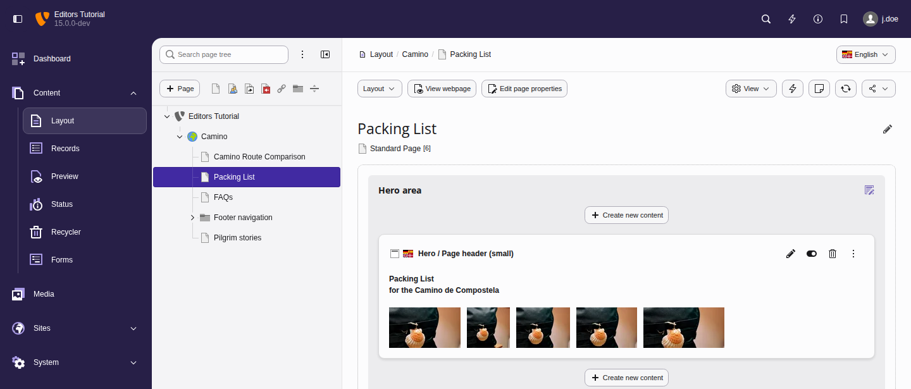

**Table of Content**

-   [Overview of the Layout module in TYPO3](https://docs.typo3.org/permalink/t3editors:overview-of-the-layout-module-in-typo3@main)
-   [Hiding content elements](https://docs.typo3.org/permalink/t3editors:hiding-content-elements@main)
-   [Moving content elements](https://docs.typo3.org/permalink/t3editors:moving-content-elements@main)
-   [Copy and paste content elements](https://docs.typo3.org/permalink/t3editors:copy-and-paste-content-elements@main)
-   [Finding content using the live search](https://docs.typo3.org/permalink/t3editors:finding-content-using-the-live-search@main)
-   [Troubleshooting page management](https://docs.typo3.org/permalink/t3editors:troubleshooting-page-management@main)

## Overview of the Layout module in TYPO3 {#content-working-overview}

<!-- TODO: no Markdown rendering for "versionchanged" -->

This module has been renamed from Web > Pages to
Content > Layout.

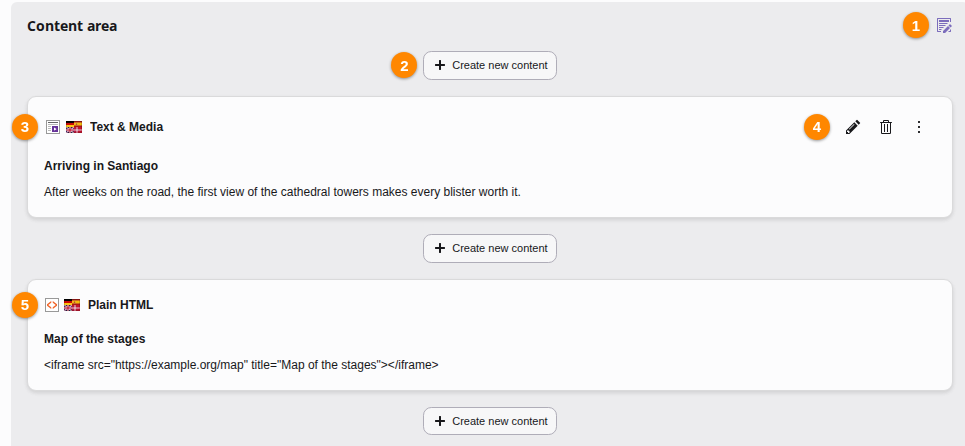

Common page icons explained:

1.  Use this icon to edit all the content elements of a column.
1.  Add a new content element to the column at this specific position.
1.  Content element icon. This can provide a visual clue to the type of content
    element. Click to access the context menu for the element (to perform
    actions like *copy*).
1.  Use these buttons to work with the element:

    -   Use the pencil icon to edit the element.
    -   Delete the element.
    -   Open the context menu.

    If you may hide content elements, a button to hide or show the element
    in the frontend appears here as well.
1.  If the buttons are missing you do not have sufficient permission to
    edit the content element in question.

## Hiding content elements {#content-working-hiding}

You can temporarily hide content that should be hidden for a while but will be
needed later. You can also hide a content element while you are still working
on it. Hidden content elements are not visible in the frontend

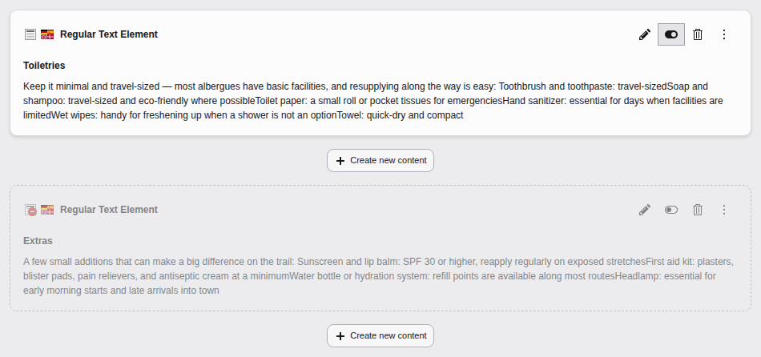

A content element can also be hidden in the "Access" tab of its edit form, its
context menu or the [Content > Layout module](https://docs.typo3.org/permalink/t3editors:using-the-list-module-effectively@main).

## Moving content elements {#content-working-moving}

You can move content elements using drag and drop. You can either drop them
in one of the highlighted areas on the current page or drop them on a different
page within the page tree.

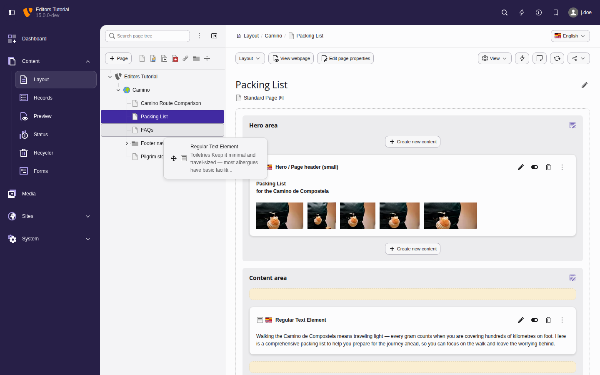

## Copy and paste content elements {#content-working-copy-paste}

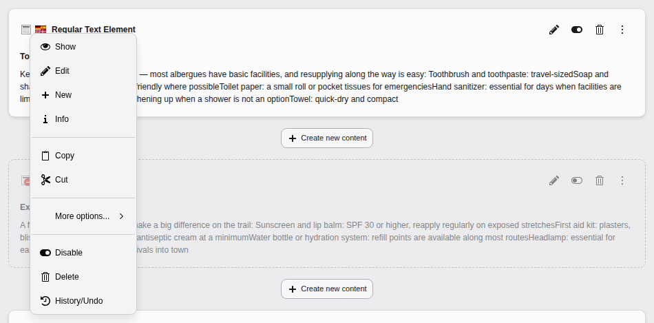

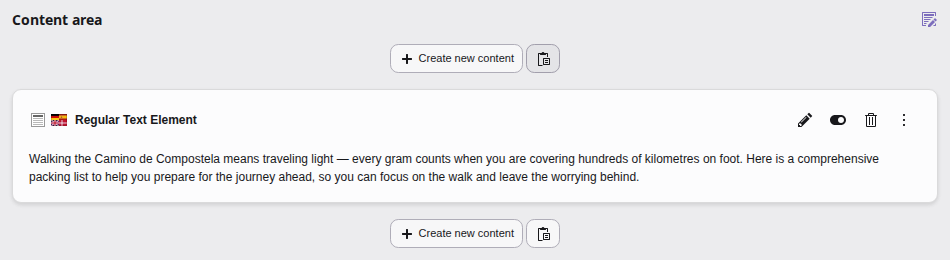

You can also copy content elements by pressing `Ctrl` during drag and drop.

Copied content is hidden by default and has the text "(copy xx)" appended to its
title. Your integrator can disable this default behaviour:
[disableHideAtCopy](https://docs.typo3.org/m/typo3/reference-typoscript/main/en-us/PageTsconfig/TceMain.html#pagetcemaintables-disablehideatcopy)
if desired.

## Finding content using the live search {#content-working-life-search}

Use the search button on the top right of the TYPO3 backend or the keyboard
shortcuts `Ctrl + K` or `Cmd + K` to open the live search.

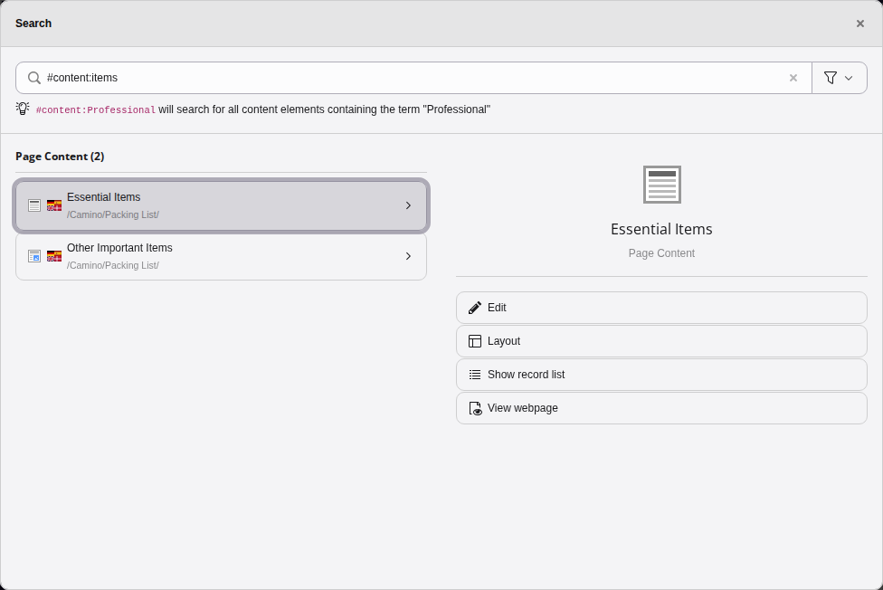

You can then edit the content element containing the text you were searching for.
You can search by keywords, numbers or by frontend page URL.

## Troubleshooting page management {#content-working-troubleshooting}

### Unused elements detected on this page {#content-working-troubleshooting-unused}

Sometimes the following warning is displayed on your page:

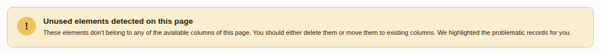

This commonly happens when you switched the
[Backend layout in the page properties](https://docs.typo3.org/permalink/t3editors:pages-properties-appearance@main).

It can also happen after imports or updates. "Unused content" is usually not
displayed on the page. You can restore it if it is still needed or delete it if
it is not needed anymore.

The "Unused content" is found at the bottom of the page module. you can move it
via drag an drop to the desired location or delete it if it is not needed anymore.

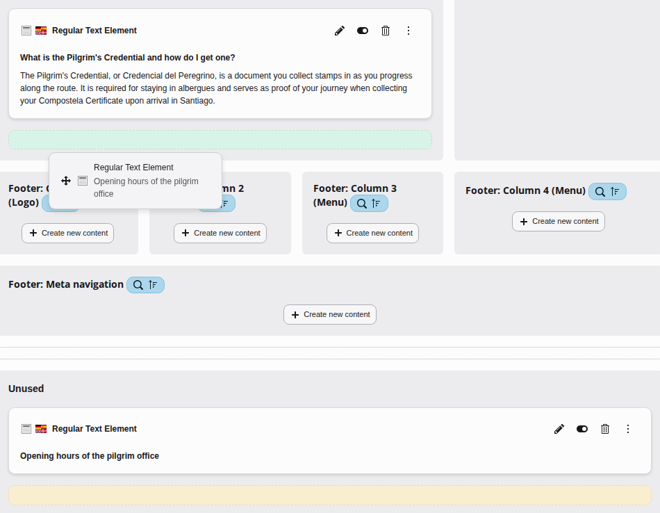

### Restore deleted content elements using the Recycler {#content-working-troubleshooting-recycler}

If you accidentally delete a content element or even a complete page you can
restore your data using the module **Content > Recycler** if you have
sufficient permissions and it is installed.

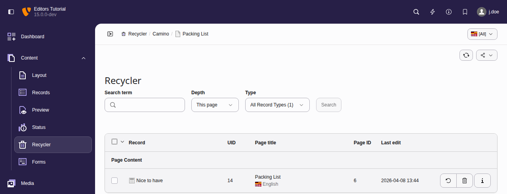

See also [Recycler manual, For editors](https://docs.typo3.org/c/typo3/cms-recycler/main/en-us/Editor/Index.html#for-editors).

### Undo changes using the page history {#content-working-troubleshooting-history}

You can use the page history to undo any kind of content changes. If you have
no access to the recycler you can also use it to restore deleted content.

Use the context menu on the page tree and choose "History/Undo".

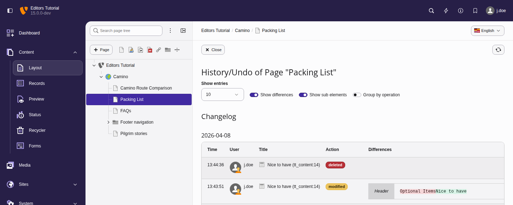

In this module you can even see a detailed view on how text or other fields
where changed and who made which changes when.

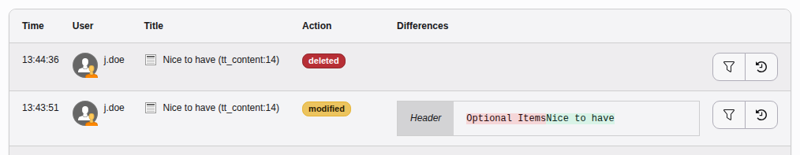

### The BE-User 'xxx' began to edit this record x min ago {#content-working-began-editing}

It is not possible in TYPO3 for two editors to work on the same content element
at the same time. The last editor who saves the content element will override
all other changes. You should therefore avoid working on content elements that
another editor is currently working on. These are marked with a warning:

![Warning: The BE-User 'Erika Doe \[e.doe\]' began to edit this record 1 hour ago.](../../Images/GeneratedScreenshots/ContentElements/ContentElementEdited.png)
