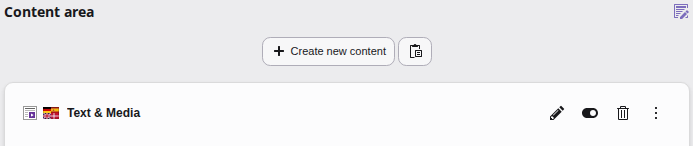
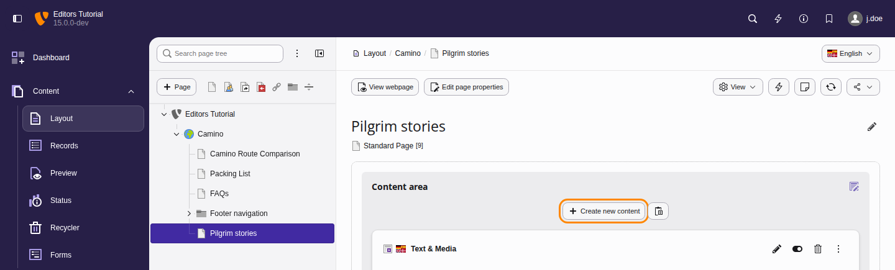
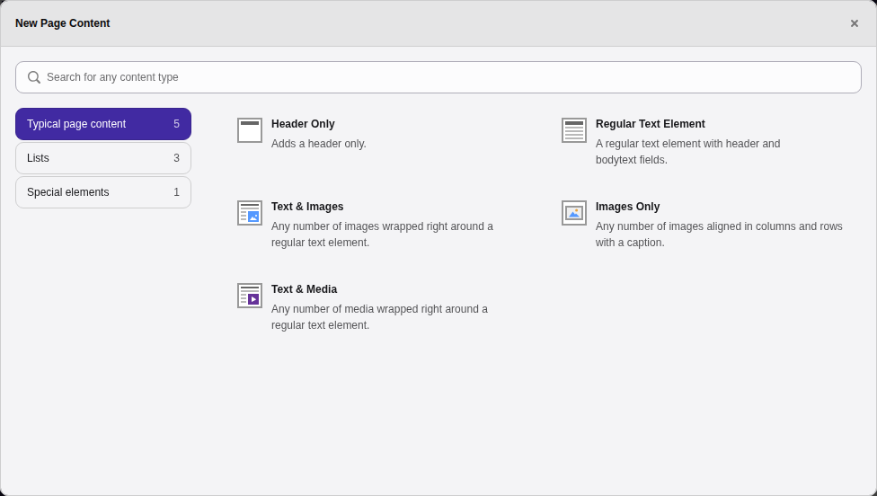
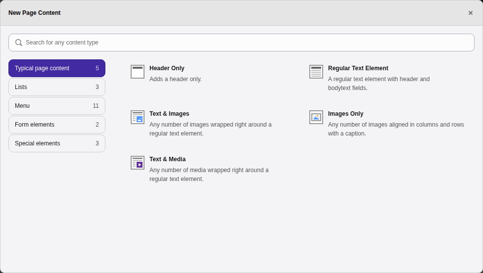
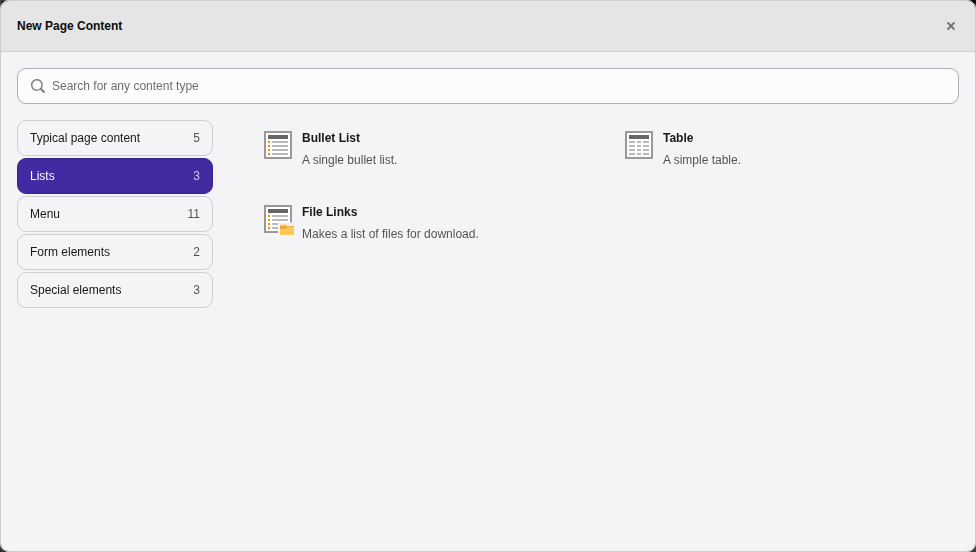
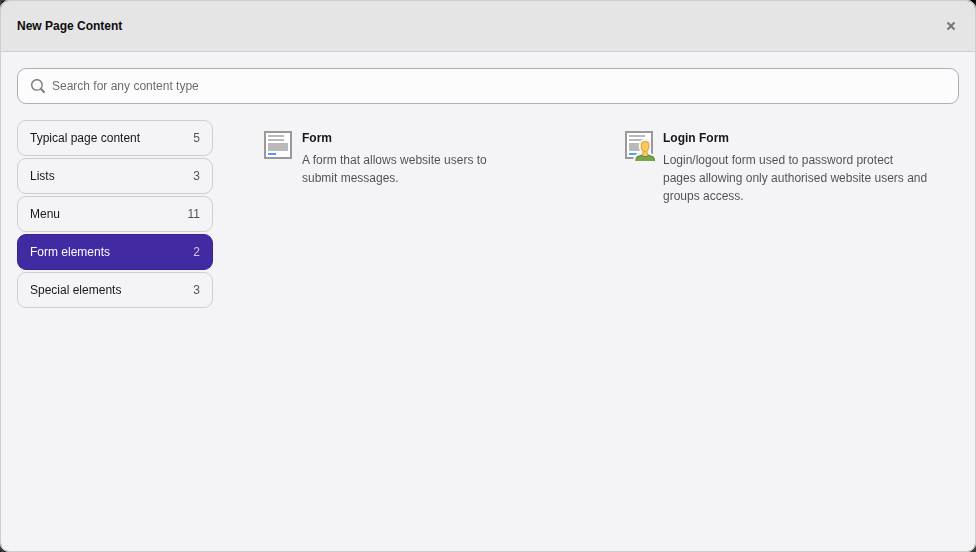
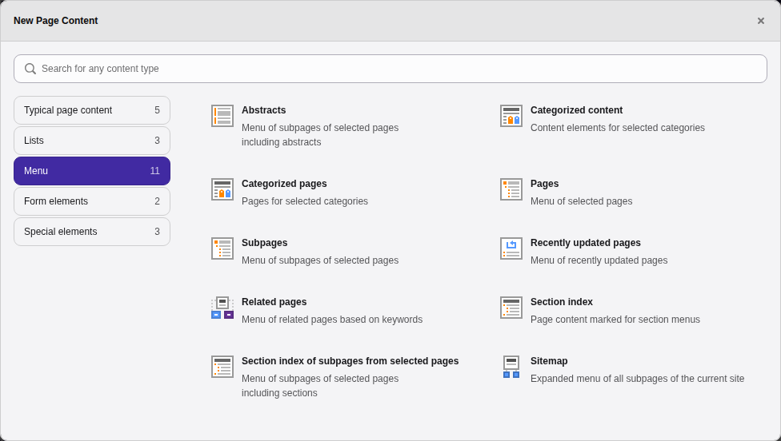
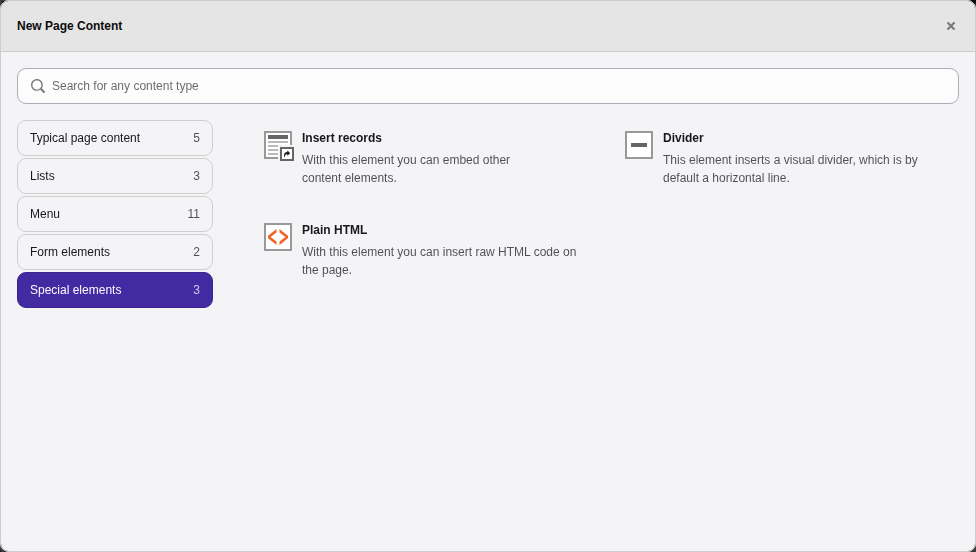
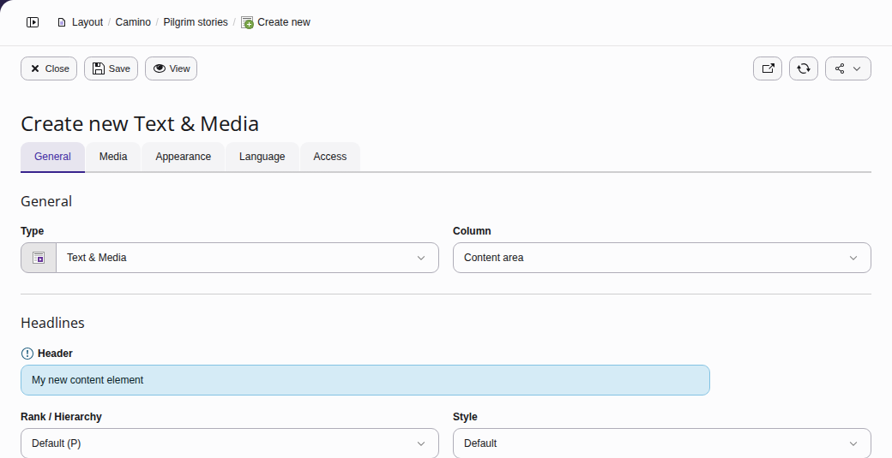
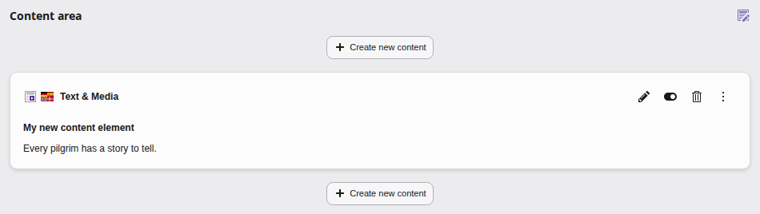

# Creating content {#content-creating}

[Watch this video on YouTube](https://www.youtube.com/watch?v=834giaL7L6M)

---

<!-- TODO: no Markdown rendering for "versionchanged" -->

The main module Web has been renamed to Content.

In the **Content > Layout** module, on any page, click the **\+
Create new content** button in the place where you want to insert content:

The **New Page Content** wizard will then be displayed.

In the following screenshot you see the location of that button:

**Table of contents:**

-   [Types of content elements](https://docs.typo3.org/permalink/t3editors:types-of-content-elements@main)
-   [Content elements seen by a typical TYPO3 editor](https://docs.typo3.org/permalink/t3editors:content-elements-seen-by-a-typical-typo3-editor@main)
-   [Advanced content elements](https://docs.typo3.org/permalink/t3editors:advanced-content-elements@main)
-   [Add new content to a page](https://docs.typo3.org/permalink/t3editors:add-new-content-to-a-page@main)

## Types of content elements {#content-types}

The content elements you can see here are provided by a standard TYPO3
installation with a site package as described in the
[TYPO3 site package tutorial](https://docs.typo3.org/m/typo3/tutorial-sitepackage/main/en-us/Index.html#start).

If you are working with a different setup you might see more, or different
content elements.

Which content elements you can see as an editor also depends on your user rights:

A standard editor can see the following content elements:

An advanced editor or an administrator can see the following content elements:

## Content elements seen by a typical TYPO3 editor {#content-types-editor}

### Typical page content {#content-typical}

Insert regular text and image content types to build standard web pages.

### Lists {#content-list}

Lists can be used for structured content. They provide less flexibility then
standard content elements but are easier to use for their specialized use case.

Depending on how the [Rendering is defined in the Site Package](https://docs.typo3.org/m/typo3/tutorial-sitepackage/main/en-us/ContentElementRendering/Index.html#content-element-rendering)
the way the results are displayed on the page might vary.

## Advanced content elements {#content-types-advanced}

The following content elements are usually visible to advanced users:

### Form elements {#content-form}

Create a login form or a simple contact form.

### Menu elements {#content-menu}

Present a menu or list of page links in different ways.

### Plugins {#content-plugin}

The tab "Plugins" is available if the integrator of your site installed an
extension that provides a plugin in this section and you have the required user
rights. Refer to the manual of the extension that provides the plugin for more
information.

### Special elements {#content-special}

Insert plain HTML, or a horizontal divider on the page. The "Insert records"
element lets you reference other content elements, i.e. reuse a content
element from another page without duplicating it.

## Add new content to a page {#content-new-element}

1.  On a page, click the **\+ Create new content** button in the area
    where you want to insert content.
1.  On the **Typical Page Content** tab, choose the "Text & Media" element.
    This is the most commonly used content type. The
    **Create new Text & Media** form appears.

    
1.  In the **Header** field, type *My new content element*.
1.  In the **Text** area, type in some text. This field uses a
    [Rich Text Editor](https://docs.typo3.org/permalink/t3editors:rte@main) (RTE).
1.  Save and close the content element.
    You can see the newly added element on the page:

    

> [!TIP]
> If you are more comfortable using shortcuts, there are different kinds of
> [keyboard commands](https://docs.typo3.org/permalink/t3editors:keyboard-commands@main) you can use in
> the backend forms.
