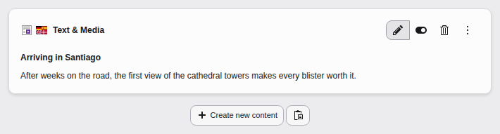
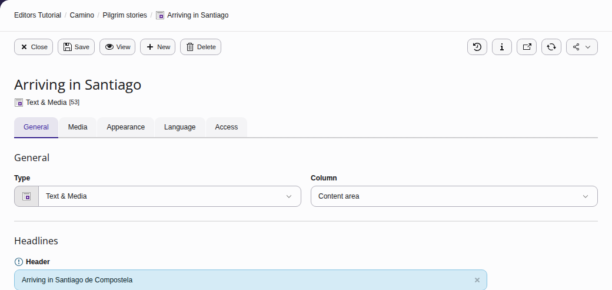
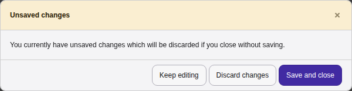
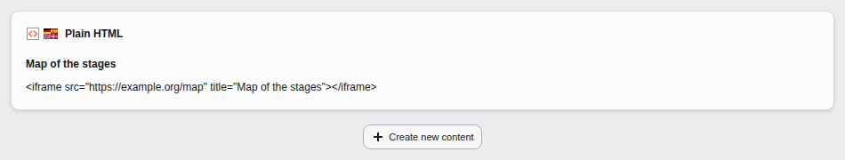
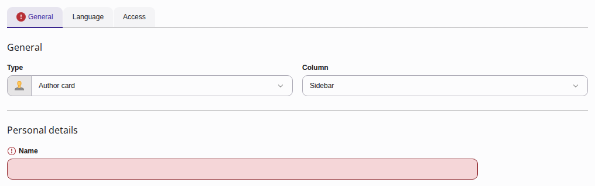
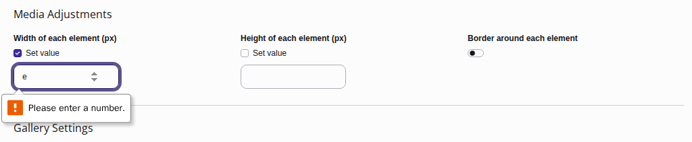
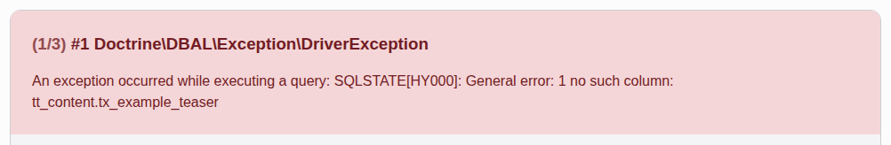
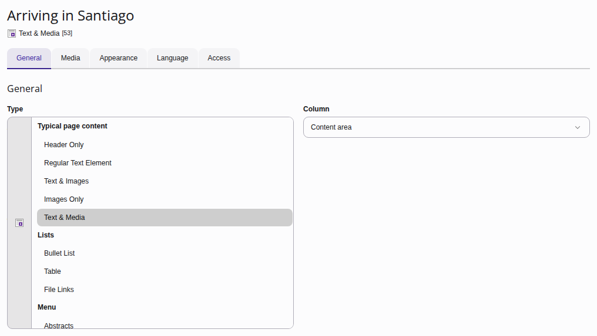
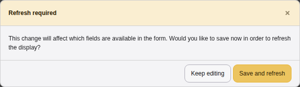

# Editing content {#content-editing}

[Watch this video on YouTube](https://www.youtube.com/watch?v=X1zP1HutQmA)

---

On a page, click the pencil icon for the content element you want to edit,
then edit the text and make other changes as required.

**Table of contents:**

-   [Changing text and setting in a content element](https://docs.typo3.org/permalink/t3editors:changing-text-and-setting-in-a-content-element@main)
-   [Troubleshooting content element edits](https://docs.typo3.org/permalink/t3editors:troubleshooting-content-element-edits@main)
-   [Changing the type of an existing content element](https://docs.typo3.org/permalink/t3editors:changing-the-type-of-an-existing-content-element@main)

## Changing text and setting in a content element {#content-editing-change-text}

Once you clicked on the edit button you can change text, images and all settings
that you have permissions for. There might be additional settings that only an
advanced editor or an administrator can see and edit. Those might be hidden to
you.

Content in the Content element forms is not auto-saved. If you try to leave
a form that has changes you will be prompted to save:

> [!WARNING]
> You are not prompted about unsaved changes if you close the browser window
> or use the browsers back button!

## Troubleshooting content element edits {#content-editing-trouble-shooting}

### Content element has no edit button {#content-editing-trouble-shooting-button}

If you have no permissions to change a content element, you will see that
element in the overview but no edit, hide or delete button appears.

Possible reasons:

-   The content element may only be edited by a user or group that created it.
-   Only admins may edit this content element.
-   The content element is of a type that your group may not edit.

An administrator can support you in finding out why you cannot edit this content
element.

### Content element does not get saved {#content-editing-trouble-saving}

If one of the fields you edited contains an illegal value now or if you did
not fill out a required field, you cannot save your changes.

If the field you changed is on a different then the currently changed tab,
you might not notice it right away.

### Error message after saving a content element {#content-editing-trouble-error}

Such error messages can happen if you are editing content during or right after
an update. Note the time and exact error message and copy the URL from your
browser where you saw the error. Send these to your integrator or programmer.

### Changes not visible in the frontend after saving a content element {#content-editing-trouble-changes-not-visible}

There can be various reasons:

-   Your browser cached the old content: Delete your
    [Browser cache](https://docs.typo3.org/permalink/t3editors:browser-cache@main).
-   Try [Previewing the page without clearing the cache](https://docs.typo3.org/permalink/t3editors:cache-preview@main).
-   Your changes did not get saved due to an error (see possible errors above).
-   Your site is using [Workspaces](https://docs.typo3.org/c/typo3/cms-workspaces/main/en-us/UsersGuide/Index.html#users-guide).
-   Try [Manual cache clearing](https://docs.typo3.org/permalink/t3editors:cache-manual@main)
    if you have the permissions to do so.
-   If problems persist, contact your administrator.

## Changing the type of an existing content element {#content-editing-type}

You can also change the content element type by selecting another element from
the **Type** list.

When you change a content element's type, the TYPO3 backend wants to reload
the screen to display different input fields, you are prompted first:

This action does not delete content. It is saved in the background and will be
restored if you select the applicable content element type again.

> [!TIP]
> If you are more comfortable using shortcuts, there are different kinds of
> [keyboard commands](https://docs.typo3.org/permalink/t3editors:keyboard-commands@main) you can use in
> the backend forms.
