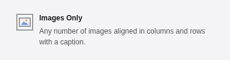
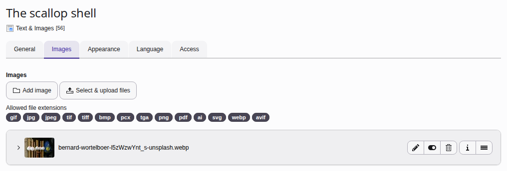
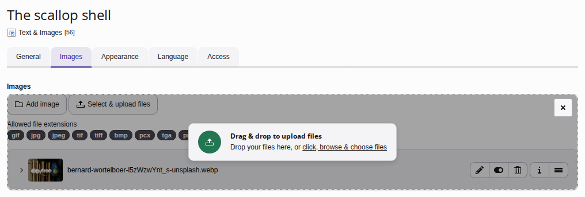
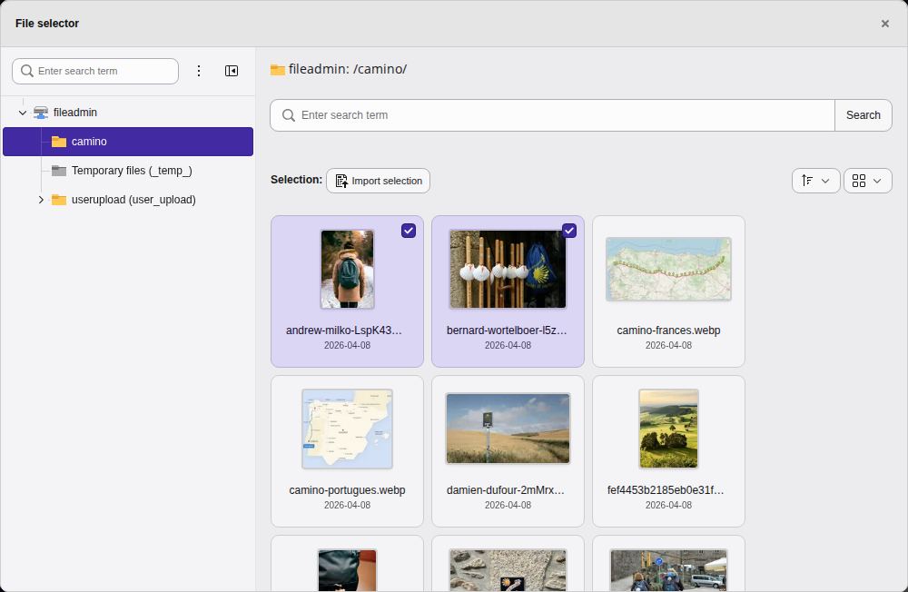
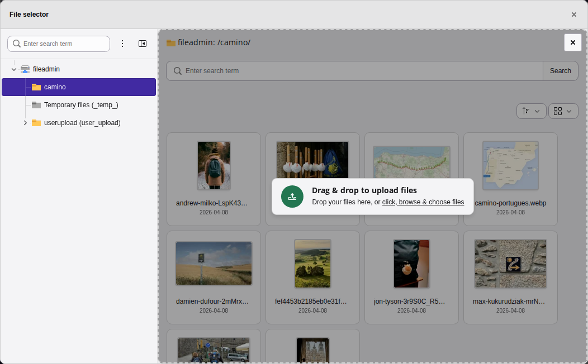
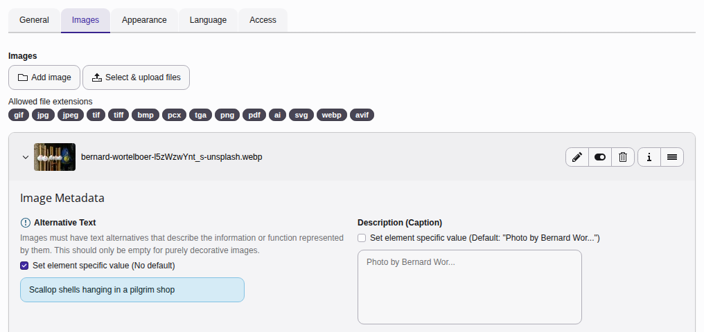
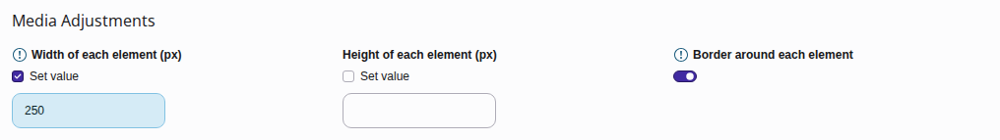
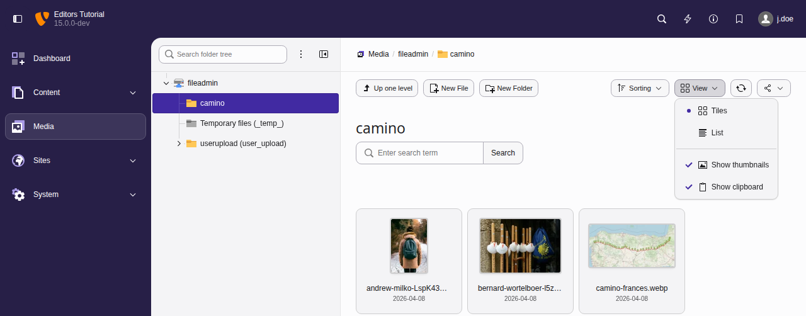
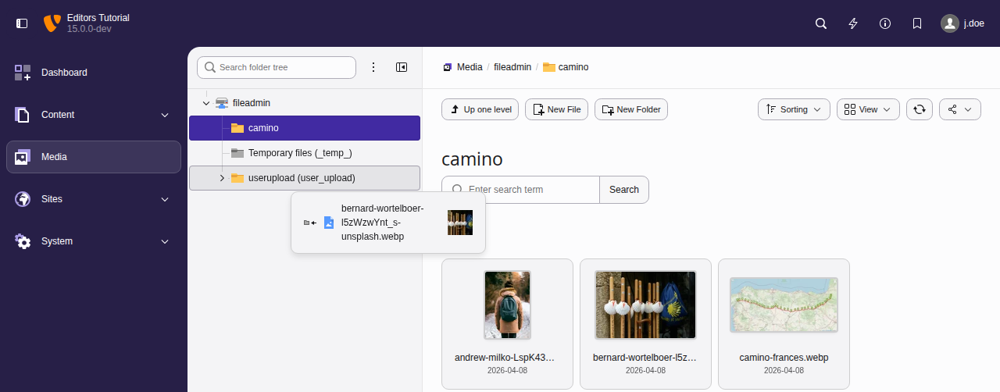
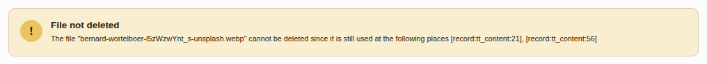

# Working with images {#images}

[Watch this video on YouTube](https://www.youtube.com/watch?v=KQ8fh_Ywktk)

---

For content elements that support images (for example Text & Images, Text &
Media, Images Only), you will see an **Images** or **Media**
tab when you create or edit the content element.

Start by [Creating a content element](https://docs.typo3.org/permalink/t3editors:content-creating@main)
of type "Text & Images", "Text & Media", or "Images Only". You can find them in the
tab [Typical page content](https://docs.typo3.org/permalink/t3editors:content-typical@main).

## Add an image to the content element {#add-image-to-page}

On the **Images** tab, click on the **Add image** button to display a
**File selector** window which lets you browse for an image.

<!-- TODO: no Markdown rendering for "versionadded" -->

You can also upload files from your computer straight into the field. TYPO3
uploads them and adds them to the field. Only files with one of the allowed
file extensions are uploaded.

-   **Drop files onto the field:** Drag the files from the file manager of your
    computer over the content element. A drop zone covers each file field,
    so you can drop the files anywhere onto the field.
-   **Paste files into the field:** Copy the files in the file manager of your
    computer, or copy image data such as a screenshot. Click into the field
    and press `Ctrl` \+ `V`. On a Mac, press `Cmd` \+ `V`.
    If you paste without clicking into a field first and the form shows
    several file fields, TYPO3 asks which field to add the files to.

Browse the file tree, then select a folder. The file selector always starts
in the root folder of the default storage. Use the search field to find a
file by name. The search includes all the subfolders of the selected folder.

<!-- TODO: no Markdown rendering for "versionadded" -->

The file selector can upload files from your computer to the folder it shows:

-   Click **Select & upload files** in the section
    **Upload files** below the files of the folder.
-   Drop the files anywhere onto the files of the folder.
-   Copy the files in the file manager of your computer, or copy image data
    such as a screenshot, and press `Ctrl` \+ `V`. On a Mac, press
    `Cmd` \+ `V`.

Only files with one of the allowed file extensions of the field are uploaded.
If a file with the same name already exists in the folder, TYPO3 asks what to
do with it. The folder then shows the uploaded files, so you can select them
right away.

## Configure the image {#configure-the-image}

The **Images** tab lets you perform a number of actions to configure an image.

### Image metadata {#override-image-metadata}

Use the small arrow next to the thumbnail to collapse and expand this section.

Here you can set general metadata including description, alt text, and
insert a link to the image.

The information displayed here is drawn from the file metadata set in the
**Media**. If required, you can override this metadata to set specific
values for the image for the current content element.

You can experiment with the image manipulation editor to crop or resize the
image. Making changes here won't impact the original image file in
**Media**.

### Media adjustments {#images-appearance}

Manually specify the width and height of the image in pixels, and apply a
border.

> [!NOTE]
> This section is only visible when your site package is based on the
> Site Package Tutorial or on Fluid Styled Content. Site Packages based on
> the Bootstrap Package have means to dynamically set the size of the images.
> The images will resize responsively to fill their container.

### Gallery settings {#images-gallery}

Choose where to position the image in relation to the text.

In "Text with Images" content elements you can position the image or images in
respect to the text here.

Multiple images are automatically arranged in columns, two by two. You can change this
behaviour with the **Number of Columns** field.

### Behavior {#images-behavior}

Use the **Enlarge on Click** setting to enable a lightbox display for the image.

> [!TIP]
> If you are more comfortable using shortcuts, there are different kinds of
> [keyboard commands](https://docs.typo3.org/permalink/t3editors:keyboard-commands@main) you can use in
> the backend forms.

## Manage your images in the Media module {#images-media}

<!-- TODO: no Markdown rendering for "versionchanged" -->

This module has been renamed from Filelist to Media.

You can manage your previously uploaded images in the backend module
**Media**:

TYPO3 uses a file abstraction layer (FAL) you can therefore move images into
different folders without affecting the frontend output of the web page, even if
they are used in multiple places.

You can move images into folders by drag and drop:

The file abstraction layer will not allow you to delete images that are still in
use in some content element:

First alter or delete all content elements that still use the file, then you can
delete the file itself.

See also chapter [Managing files in the Fileadmin](https://docs.typo3.org/permalink/t3editors:managing-files-in-typo@main).
