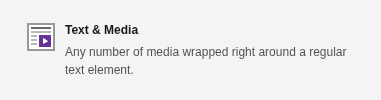
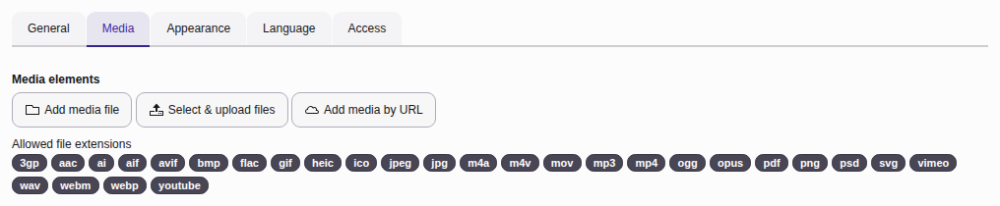

# Embedding videos as content into a TYPO3 website {#media}

The "Text & Media" content element extends the capabilities of
the ["Text & Image"](https://docs.typo3.org/permalink/t3editors:images@main)
content element (introduced in the previous chapter) by supporting a
wider range of media types. While "Text & Image"
focuses on combining text and static images, "Text & Media"
allows you to embed dynamic media, such as videos and audio files.

It also provides the option to embed content from external platforms
like YouTube and Vimeo. The specific file types and formats
supported (e.g., audio and video) depend on your site's configuration,
including any installed extensions that may add support for additional
formats. A list of allowed file extensions and pseudo-formats
(e.g., YouTube, Vimeo) is displayed below the element selector.

This enhanced functionality makes "Text & Media" a versatile choice
for presenting multimedia content alongside textual information.

> [!TIP]
> There is a large number of third party TYPO3 extensions to display a video
> player or embed a video from an external source. If one of those is used
> refer to the manual of the extension in use.

## Add a video to a page {#add-video-to-page}

If you want to embed a previously uploaded video or upload a new video use the
button **Add media file**. If you want to embed a video from an external
source like YouTube or Vimeo, use the button **Add media by URL** instead.

> [!NOTE]
> For technical security reasons the maximal upload size is limited. Images can have
> large file sizes. If you cannot upload a video yourself, ask your
> administrator to do it for you or upload it on an external plattform and
> embed it.

## Configure the video {#configure-the-video}

Use the **Autoplay** setting to specify whether the video should
start playing as soon as the page loads.

You can configure various settings for media files (for example, adding a
border, setting page position and behavior) just as you would to
[configure an image](https://docs.typo3.org/permalink/t3editors:configure-the-image@main).

## External video sources and data privacy {#video-data-privacy}

Using certain external video sources can have legal consequences concerning
data privacy laws in your country.

Talk to your Data Protection Officer (DPO) or legal department. Ask your
integrator to install an extension that ensures you can use YouTube without
data privacy issues on your page.

Extension [`b13/twoclickmedia`](https://packagist.org/packages/b13/twoclickmedia) enables you to use the
standard "Text & Media" content element while requiring consent from your
readers before any data is sent to YouTube.

Other extensions like [`t3brightside/youtubevideo`](https://packagist.org/packages/t3brightside/youtubevideo) provide their own
content element.
