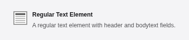
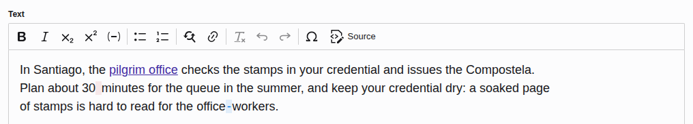
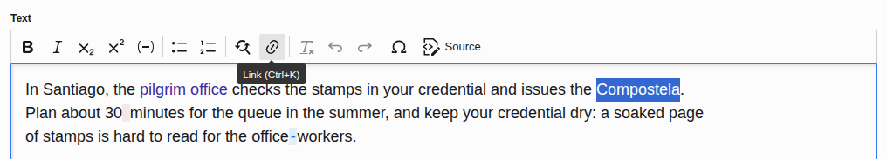
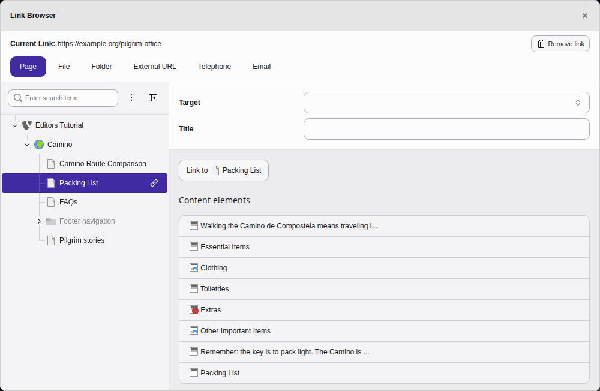
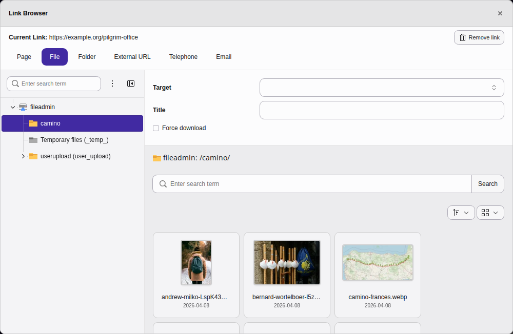
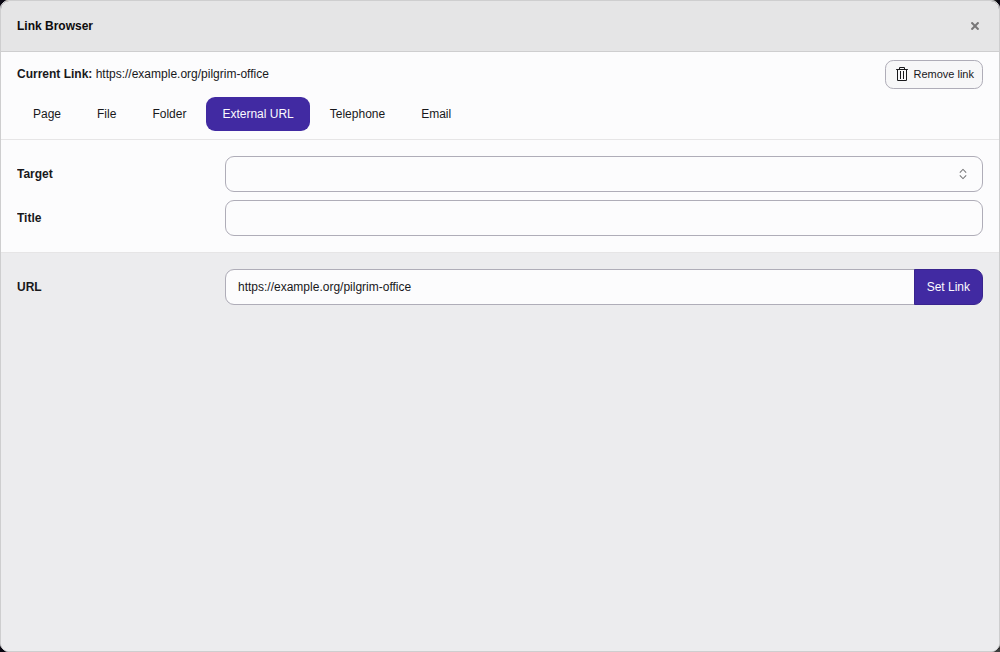
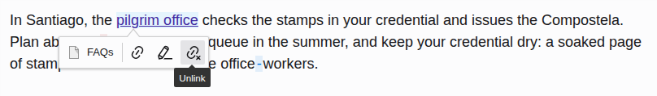
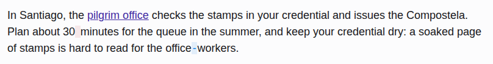

# The rich text editor {#rte}

[Watch this video on YouTube](https://www.youtube.com/watch?v=7g4HIEU3uPA)

---

Start by [Creating a content element](https://docs.typo3.org/permalink/t3editors:content-creating@main)
of type "Text & Images", "Text & Media", or "Regular Text Element". You can find them in the
tab [Typical page content](https://docs.typo3.org/permalink/t3editors:content-typical@main).

The TYPO3 text editing interface is not much different from a word processor.
The options available in the toolbars vary depending on how your TYPO3
installation is configured.

You can format text, set the alignment, insert tables and symbols and add
internal and external links to text.

## Creating a link {#rte-linking}

Select the text you want to link.

Click the **Link** icon in the toolbar or use the shortcut
`Ctrl + K` or `Cmd + K`. This shortcut only works when
your focus is within the editor. Outside the editor the same
shortcut would open the live search.

<!-- TODO: no Markdown rendering for "versionadded" -->

If you insert a link without selecting text first, TYPO3 uses the title of
the link as link text. If the link has no title, TYPO3 uses the title of the
link target, for example the title of the page. The new link stays selected,
so you can change it right away.

The **Link Browser** window displays.

This window lets you link to an internal page, file, folder, external
URL, email address or phone number.

### Internal links {#rte-linking-internal}

You can link to an internal file, folder, page or content element on a page.

On the **Page** tab, select the page in the page tree that you want
to link to, then click the **Link to ...** button.

You can also link directly to a content element. In that case an anchor
(link with a hashtag) is used so your readers will automatically jump to the
desired content element.

You can also link to uploaded files, for example PDF files:

### External links {#rte-linking-external}

1.  In the **Link Browser** window, go to the **External URL** tab.
1.  Type your link in the **URL** field.
1.  In the Target drop-down list, select **New window** to open the
    link in a new browser window.

    
1.  Click the **Set Link** button to close the **Link Browser**
    window.

## Checking and opening a link {#rte-linking-preview}

<!-- TODO: no Markdown rendering for "versionadded" -->

When you put your cursor into a link, a popover shows where the link goes.
For a page or a file, it shows the icon and the title of the target. Hover
over the title to see the path of the page or file. For an external link, the
popover shows the address.

To open the link in a new browser tab, click the
**Open link in new tab** button in the popover. You can also click
the link while you hold `Ctrl`, or `Cmd` on a Mac, or press
`Alt` \+ `Enter` while your cursor is in the link. A link to a page
opens the page in the frontend, and a link to a file opens the file.

## Removing a link {#rte-linking-remove}

To remove a link from text, put your cursor anywhere in the linked text then
click the **Unlink** button in the popover:

## Non-breaking spaces and soft hyphens {#rte-whitespace}

Two characters that are normally invisible are highlighted with a colour in the
rich text editor so that you can see where they have been placed:

-   A **non-breaking space** keeps two words together on the same line, so they
    are never split across a line break.
-   A **soft hyphen** marks a point where a word may be hyphenated and wrapped to
    the next line, but only if the word does not otherwise fit.

The colour highlighting is only shown while you edit. It helps you spot these
characters in the editor and does not appear on the website itself.

You can insert both characters with a [keyboard command](https://docs.typo3.org/permalink/t3editors:keyboard-commands-rte@main).
