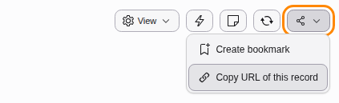
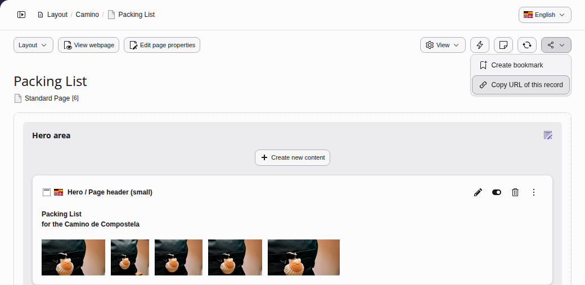
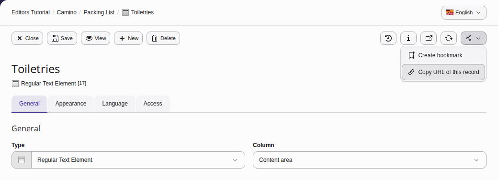
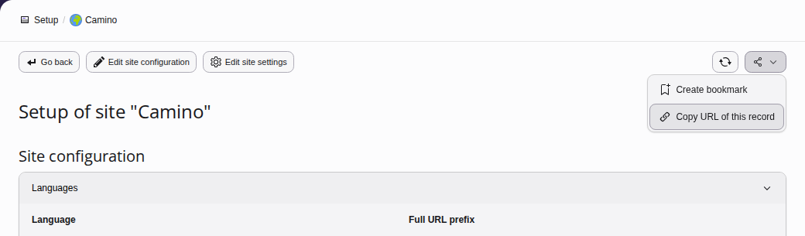
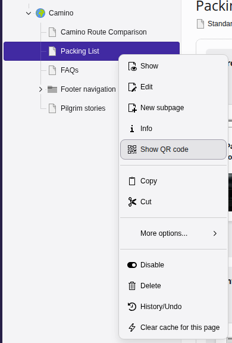
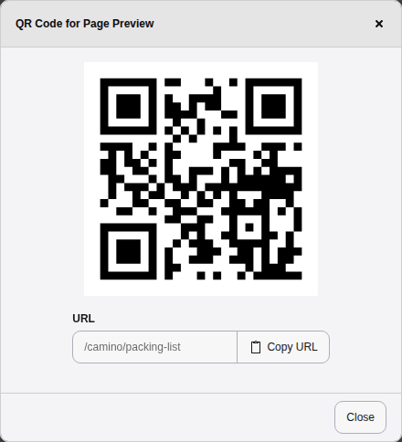

# Deep linking {#deeplinking}

Deep linking allows users to share links to specific pages, content elements and modules
from within TYPO3's backend.

For example, a user could be writing content for a new page that is about
to be published. Using deep links, they can share a link to the page
they are working on or even share a link to the actual content element that contains
their work and send it to another member of the team for review.

## Sharing links {#deeplinking-sharing}

To share a link, look for the **Share** icon located at the top right hand side of any
page in the backend. Its menu item **Copy URL of this record**
copies the link.

### Linking to a page {#deeplinking-sharing-linking-page}

The example below creates a deep link to the `Packing List` page:

### Linking to a content element {#deeplinking-sharing-linking-content-element}

This example creates a deep link to the `Toiletries` content element on the
`Packing List` page:

### Linking to backend modules {#deeplinking-sharing-linking-backend-modules}

It is possible to create links to places within backend modules. This example creates a link
to the setup of the site `Camino` in the **Sites > Setup** module.

## URLs and deep links {#deeplinking-bestpractices}

When creating links to anything in the backend, it is recommended that the
**Share** button is used to generate the link. Copying the URL from the browser
is not recommended.

## Sharing a preview with a QR code {#deeplinking-qr-code}

<!-- TODO: no Markdown rendering for "versionadded" -->

A QR code takes you to the page in the frontend, for example to check the
page on your phone, or to show it to someone else. There are two ways to open
the QR code of a page:

-   In the page tree, right-click the page and choose
    **Show QR code**. The context menu of a page offers the item
    wherever a page is listed.
-   In the modules **Content > Records** and
    **Content > Preview**, click the **Show QR code** button
    in the top bar.

A dialog shows the QR code. Scan it with the camera of your phone or tablet
to open the page. Below the code, the field **URL** shows the address
of the page, and **Copy URL** copies it.

In a workspace, the QR code leads to a preview of the changes in the
workspace, which works without logging in to the backend. You can send it to
colleagues or clients who have no backend account, so they can review the
changes before they are published. The module **Content > Publish**
offers the QR code for each change in its list as well.
