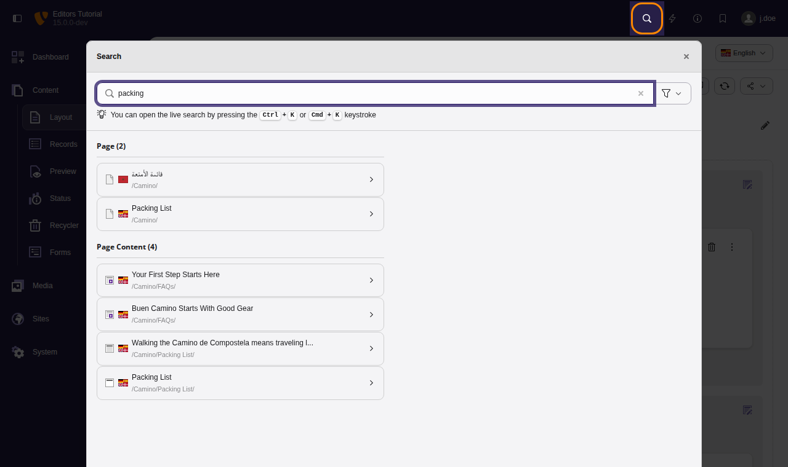

# Backend search {#backend-search}

The backend search tool accepts text and searches against
page records, content records, database records and backend modules.

The search can be opened by selecting the magnifying glass in the top right
corner of the toolbar or by pressing the `Cmd` \+ `K`
keystroke on macOS or the `Ctrl` \+ `K` keystroke on Windows and Linux
systems.

