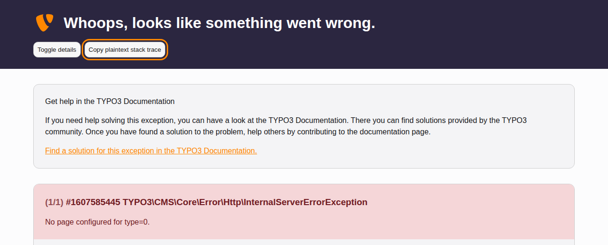

# What to do when an error page shows {#error-page}

Sometimes TYPO3 cannot finish what you asked for and shows an error page
instead. You cannot fix the error yourself, but you can help the person who
can. What they need depends on which error page you see.

## On the live website {#error-page-live}

The live website shows a short page titled **Oops, an error occurred!**. It
leaves out the details on purpose, so visitors learn nothing about the inner
workings of the site.

Tell your administrator or agency which page you were on, what you clicked
and at what time. TYPO3 has written the details into its log, so that is all
they need from you.

## On a development or test system {#error-page-details}

<!-- TODO: no Markdown rendering for "versionadded" -->

On a development or test system, the error page has a dark header reading
**Whoops, looks like something went wrong.** Below it, TYPO3 shows the error
and the list of program files that led to it, also called the stack trace.

Instead of taking a screenshot, send the whole error report as text:

1.  Click **Copy plaintext stack trace** in the header of the page.
1.  Paste the text into your message to your administrator or agency, for
    example into an email or a ticket.
1.  Read through the text before you send it, and remove anything that should
    not leave your company, such as passwords or personal data. The error page
    reminds you of this at the end of the report.

> [!NOTE]
> If the address in your browser starts with `http://` instead of
> `https://`, the browser may refuse to copy. TYPO3 then shows the text in a
> box on the page, already selected. Press `Ctrl` \+ `C`
> (`Cmd` \+ `C` on a Mac) to copy it yourself.
