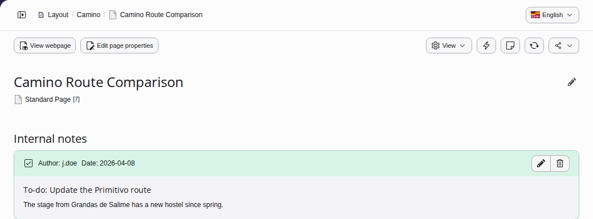
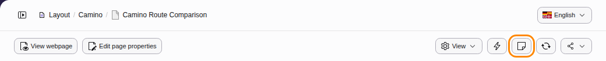

# Internal notes in the TYPO3 backend {#internal-notes}

> [!NOTE]
> These are only available if [`typo3/cms-sys-note`](https://packagist.org/packages/typo3/cms-sys-note) is installed
> and your administrator granted you the necessary user rights.

Internal notes, also called system notes, are small text notes that are
displayed in the [Layout module](https://docs.typo3.org/permalink/t3editors:content-creating@main)
and [Records module](https://docs.typo3.org/permalink/t3editors:using-the-list-module-effectively@main).

You can use them to write notes to yourself or other editors. Administrators
can use them to write notes to you as well.

They look like this:

> [!NOTE]
> **See also**
>
> For a detailed description on how to use the internal notes see
> [System notes manual, for Editors](https://docs.typo3.org/c/typo3/cms-sys-note/main/en-us/Editor/Index.html#for-editors).
