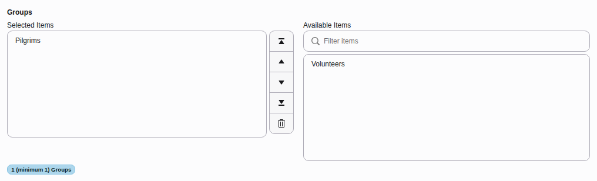
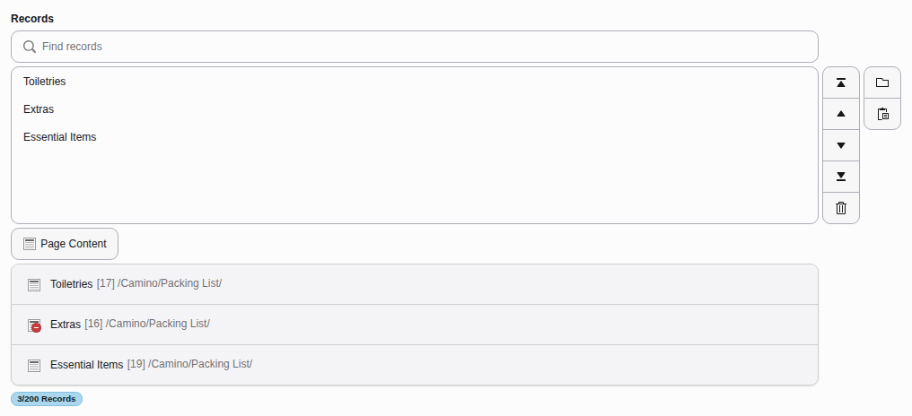

# Keyboard commands {#keyboard-commands}

-   [Navigating the page tree using a keyboard](https://docs.typo3.org/permalink/t3editors:navigating-the-page-tree-using-a-keyboard@main)
-   [Actions in backend forms](https://docs.typo3.org/permalink/t3editors:actions-in-backend-forms@main)
-   [Editing text in the rich text editor (RTE)](https://docs.typo3.org/permalink/t3editors:editing-text-in-the-rich-text-editor-rte@main)
-   [Reloading pages and clearing browser cache](https://docs.typo3.org/permalink/t3editors:reloading-pages-and-clearing-browser-cache@main)
-   [Opening the backend search modal](https://docs.typo3.org/permalink/t3editors:opening-the-backend-search-modal@main)
-   [Multiselect in content elements](https://docs.typo3.org/permalink/t3editors:multiselect-in-content-elements@main)

## Navigating the page tree using a keyboard {#keyboard-commands-page-tree}

It is possible to navigate the page tree using only a keyboard and it adheres to
the guidelines set out in [WAI-ARIA Authoring Practices 1.1.](https://www.w3.org/TR/wai-aria-practices-1.1/#keyboard-interaction-22)

-   `Home` moves the focus to the first item in the page tree.
-   `End` moves the focus to the last item in the page tree.
-   `Enter` either expands the item or selects it.
-   `Up` and  `Down` arrow keys will move the focus up and down the page tree.
-   `Right` arrow key will expand the focus if possible.
-   `Left` arrow key will close the focus if possible.

## Actions in backend forms {#keyboard-commands-forms}

**Windows / Linux**

-   `ctrl` \+ `s` = Save
-   `ctrl` \+ `shift` \+ `s` = Save and close

**macOs**

-   `cmd (⌘)` \+ `s` = Save
-   `cmd (⌘)` \+ `shift` \+ `s` = Save and close

## Editing text in the rich text editor (RTE) {#keyboard-commands-rte}

Below is a list of common keyboard commands that can be used when editing
text in TYPO3's [RTE](https://docs.typo3.org/permalink/t3editors:rte@main).

**Windows / Linux**

-   `ctrl` \+ `a` = Select all text
-   `ctrl` \+ `c` = Copy
-   `ctrl` \+ `v` = Paste
-   `ctrl` \+ `x` = Cut
-   `ctrl` \+ `z` = Undo
-   `ctrl` \+ `i` = Italic
-   `ctrl` \+ `b` = Bold
-   `ctrl` \+ `shift` \+ `space` = Insert non-breaking space
-   `ctrl` \+ `shift` \+ `-` = Insert soft hyphen

**macOs**

-   `cmd (⌘)` \+ `a` = Select all text
-   `cmd (⌘)` \+ `c` = Copy
-   `cmd (⌘)` \+ `v` = Paste
-   `cmd (⌘)` \+ `x` = Cut
-   `cmd (⌘)` \+ `z` = Undo
-   `cmd (⌘)` \+ `i` = Italic
-   `cmd (⌘)` \+ `b` = Bold
-   `alt` \+ `shift` \+ `space` = Insert non-breaking space
-   `alt` \+ `shift` \+ `-` = Insert soft hyphen

## Reloading pages and clearing browser cache {#keyboard-commands-browser}

**Windows / Linux**

-   `F5` = Reload
-   `ctrl` \+ `F5` = Reload page and clear browser cache

**macOS**

-   `cmd (⌘)` \+ `r` = Reload page
-   `cmd (⌘)` \+ `option (⌥)` \+ `r` = Reload page and clear browser cache

## Opening the backend search modal {#keyboard-commands-search}

<!-- TODO: no Markdown rendering for "versionadded" -->

**Windows / Linux**

-   `ctrl` \+ `k`

**macOS**

-   `cmd (⌘)` \+ `k`

## Multiselect in content elements {#keyboard-commands-multiselect}

<!-- TODO: no Markdown rendering for "versionadded" -->

The keyboard commands can be used on a select element:

Or a group element:

Selecting and deselecting options with the keyboard:

-   `enter` = Add options, either from right to left or left to right
-   `delete` or `backspace` = Remove an option for Windows and Mac users
-   `alt` \+ `arrow up` = Move the option one up
-   `alt` \+ `arrow down` = Move the option one down
-   `alt` \+ `shift` \+ `arrow up` = Move the option to the top
-   `alt` \+ `shift` \+ `arrow down` = Move the option to the bottom

More combinations:

-   `shift` \+ `arrow up` = Include the upper option
-   `shift` \+ `arrow down` = Include the lower option
-   `home` = Move the cursor to the top
-   `end` = Move the cursor to the bottom
