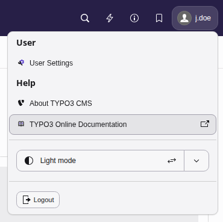

# TYPO3 online documentation {#typo3-online-documentation}

The starting page of the official TYPO3 documentation is at
[https://docs.typo3.org/](https://docs.typo3.org/) .

However, you can also open this documentation from your TYPO3 backend. Click on your name
in the right corner of top bar, and then click on
**TYPO3 Online Documentation** in the drop down menu.

