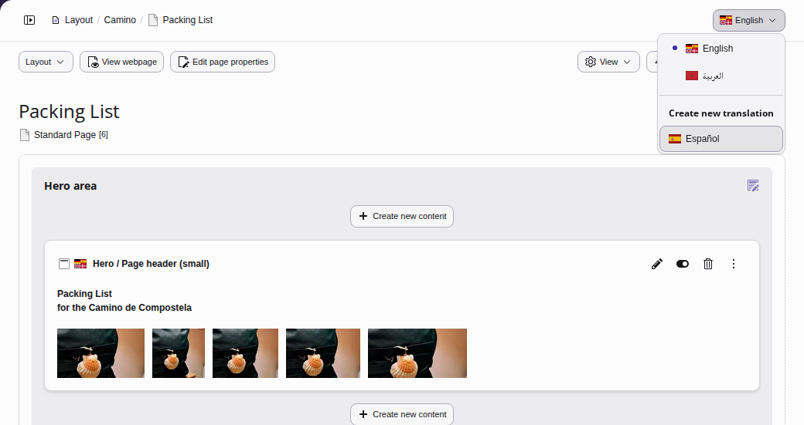
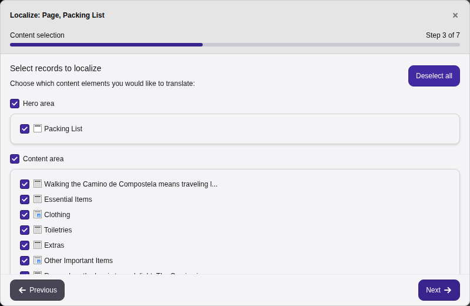
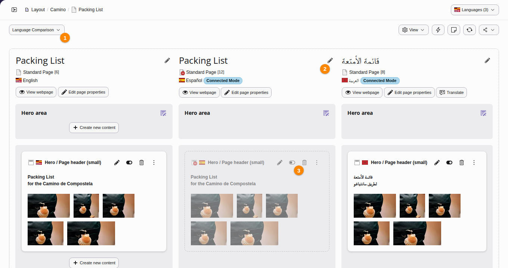
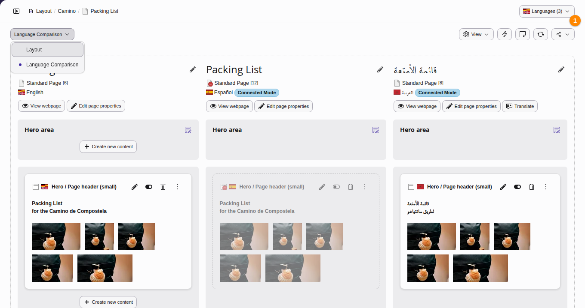

# Working with languages {#languages}

TYPO3 CMS comes with built-in support for managing multi-language sites from a
single installation.

> [!NOTE]
> **See also**
>
> More detailed information can be found in the
> [Frontend Localization Guide](https://docs.typo3.org/m/typo3/guide-frontendlocalization/main/en-us/Index.html#start).

[Watch this video on YouTube](https://www.youtube.com/watch?v=XzKBdjUV53k)

---

## Language configuration {#languages-new}

Languages are managed at the site level. To add or configure languages for a
site, navigate to **Site Management > Sites**.

> [!NOTE]
> Managing site languages requires administrative privileges. For detailed setup
> instructions, see the [Site Handling](https://docs.typo3.org/m/typo3/reference-coreapi/main/en-us/ApiOverview/SiteHandling/Basics.html#sitehandling-basics)
> documentation.

## Translation strategies {#translation-modes}

When you translate content, there are two modes: a
[connected](https://docs.typo3.org/permalink/t3editors:languages-translation-mode-connected@main) mode and an
[independent](https://docs.typo3.org/permalink/t3editors:languages-translation-mode-copy@main) mode.

### Translate (connected) {#languages-translation-mode-connected}

Use this mode if your site requires a strict, parallel content structure across
all languages. TYPO3 maintains a direct link between the source element and its
translation.

-   When the source text changes, TYPO3 marks the translation as out of date.
-   While you are translating, you can see the changes in the source language next
    to your text.
-   Translation teams can be notified and can track what still needs review.

### Copy (independent) {#languages-translation-mode-copy}

Use this mode if your localized pages require unique layouts, different content
structures, or completely independent text.

-   Decoupled content: TYPO3 creates a standalone copy of the source content in
    the target language.
-   Structural freedom: No link is maintained, allowing the localized page
    structure to diverge entirely from the source.

## Localizing a page {#languages-translations}

Follow these steps to translate a page and its content elements.

### Create the page translation {#languages-create-page-translation}

1.  Navigate to the **Content > Layout** module and select the page you
    want to translate.
1.  Locate the **Create new translation** dropdown and select
    the target language that you want to translate into, making sure the target
    language has been configured in **Site Management > Sites**. This
    will open the translation wizard.

    
1.  Click through the translation wizard, choosing a translation mode of
    **Translate** or **Copy**
    (see [Translation strategies](https://docs.typo3.org/permalink/t3editors:translation-modes@main)) for each content
    element on the page until you see **Localization completed**. The
    last screen of the wizard shows a summary of what will be translated.
    Click on the **Finish** button.

    
1.  Click on **Language Comparison** (1). The screen now
    displays the versions of the page side by side: the default language
    version on the left and the translations next to it. Choose the
    languages to compare in the language menu. Translate **page**
    fields such as the title by clicking the pencil icon (2) and typing in
    your translations. The new content elements in the target language are
    hidden in the frontend by default. **Enable** (3) each content element
    after you have finished translating its text.

    

## Changing the view {#adjusting-the-view}

Change the view from side-by-side pages to a single language by clicking on
**Layout** mode and then choosing the language you want to see (1).

The **Content > Records** module has a language menu as well, see
[Showing the records of certain languages](https://docs.typo3.org/permalink/t3editors:list-module-languages@main).

## Next steps {#next-steps-l10n}

The [Frontend Localization Guide](https://docs.typo3.org/m/typo3/guide-frontendlocalization/main/en-us/Index.html#start)
contains detailed information about setting up a multilingual web site and how to
do translation and localization.

[Site Handling](https://docs.typo3.org/m/typo3/reference-coreapi/main/en-us/ApiOverview/SiteHandling/Basics.html#sitehandling-basics) contains
information about how to add more languages to your site configuration.
