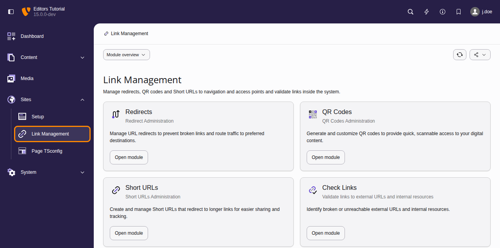

# Link management {#link-management}

There are various features available within TYPO3 that enable users to
create, edit and manage different types of links, including [Redirects](https://docs.typo3.org/permalink/t3editors:redirects@main), [QR Codes](https://docs.typo3.org/permalink/t3editors:qr-codes@main) and
[Short URLs](https://docs.typo3.org/permalink/t3editors:short-urls@main).

To use these features, you will need access to **Link Management**, which is
located within the Sites module.

> [!TIP]
> If you cannot see the Link Management module, it is likely that either you have
> not been granted the appropriate permission to access it, or the [Redirects System
> Extension](https://docs.typo3.org/c/typo3/cms-redirects/main/en-us/Index.html)
> is not installed and activated on your TYPO3 installation.
>
> If this is the case, contact your TYPO3 System Administrator for further assistance.

**Chapters**

**[Redirects](https://docs.typo3.org/permalink/t3editors:redirects@main)**

Create and manage redirects from the Redirects module. Here you can also
view existing rules and see how many times they've been accessed.

**[QR Codes](https://docs.typo3.org/permalink/t3editors:qr-codes@main)**

QR Codes are a convenient way to share links to a given page, file
or external URL from your TYPO3 installation.

**[Short URLs](https://docs.typo3.org/permalink/t3editors:short-urls@main)**

Generate and share Short URLs that link back to pages, files or external URLs
from your TYPO3 installation.
