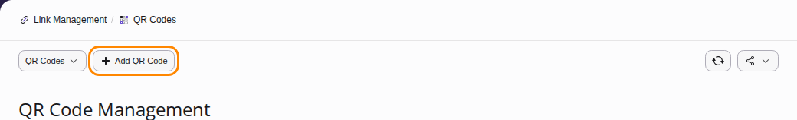
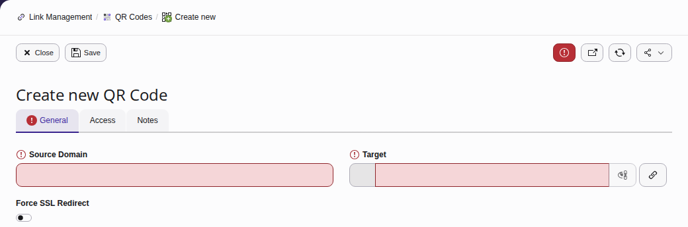
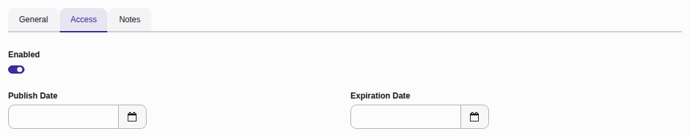
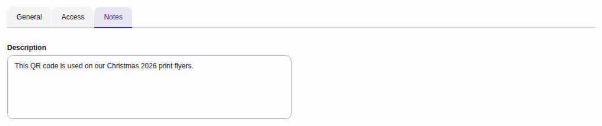
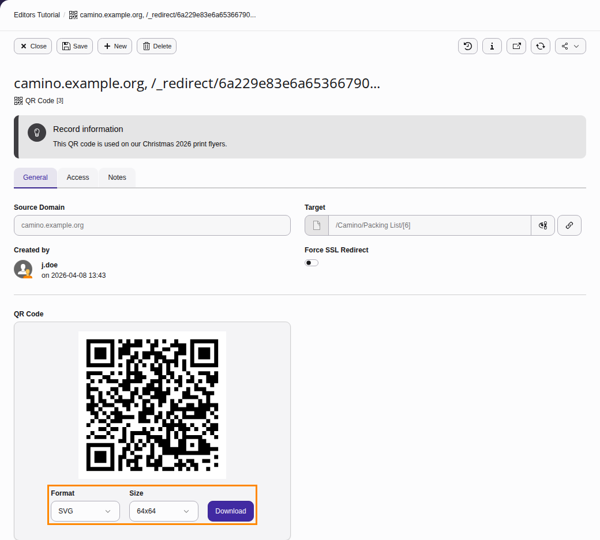
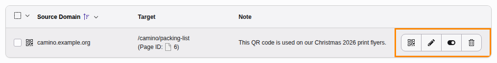

# Quick response (QR) codes {#qr-codes}

In this chapter you will learn how to create Quick Response codes and have them
link to pages in TYPO3's Page Tree, ready to be shared.

## Scenario - sharing your QR code {#qr-codes-scenario}

You have a Christmas marketing campaign coming up and you're getting ready to print
several hundred flyers to promote your campaign.

You want to add a QR Code to your flyer so that when a potential customer scans it, they are
sent to a specific page in your TYPO3 installation.

Using the QR Code feature, you can:

-   Generate a QR Code
-   Point it to a page in the Page Tree.
-   Download the QR Code either as a PNG or SVG and then send it to your design department so that they can add it to the flyer

## Creating a QR code {#qr-codes-creating}

From the Link Management module, select **QR Codes** followed by **Add QR Code** or **Create new QR Code**.

### General tab {#qr-codes-general-tab}

**Source Domain**: Select the domain you wish to associate with the QR Code. If you only have one site in your installation, there will be only one option to choose from.

**Target**: Specify which page in the **Page Tree** your QRC will point to. It is also possible to link to Files stored in TYPO3 and also point to external URLs.

**Force SSL Redirect**: Force all requests to be served via https.

### Access tab {#qr-codes-access-tab}

**Enabled**: Toggle the QRC on and off.

**Publish Date**: Set a publish date for when you want the QR Code to become active.

**Expiration Date**: Set an expiration date or when you want the QR Code to be no longer active.

### Notes tab {#qr-codes-notes-tab}

Add an internal note that other backend users can view.

## Downloading your new QR code {#qr-codes-download}

Once you have created your QRC, it can then be downloaded via two different formats with several pre-set sizes available.

PNG: `64x64`, `128x128`, `256x256` and `512x512`

SVG: `64x64`, `128x128`, `256x256` and `512x512`

## Edit an existing QR code {#qr-codes-edit}

**Show QR Code**: Download the QRC.

**Edit Icon**: Once a QRC has been created, it is possible to change where it points to.

**Hide**: Enable or disable the QRC without deleting it. If the QR Code is disabled, a 404 page will be returned.

**Delete**: Delete the QRC.
