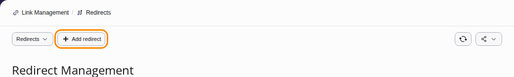
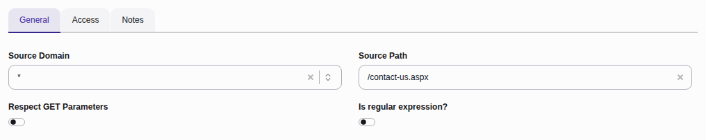
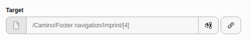
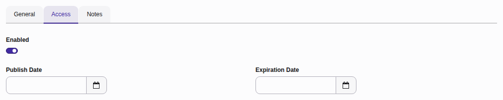
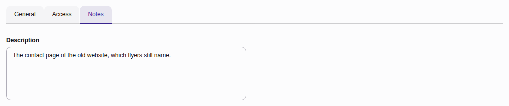
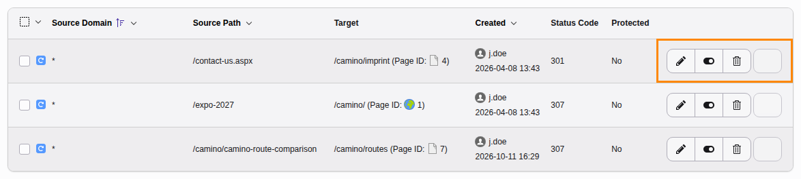

# Redirects {#redirects}

With Redirects, users are able to redirect inbound traffic to Pages, Files or External URLs.

## Scenario - preserving old URLs {#redirects-scenario-preserving}

You have successfully migrated your site to TYPO3, however you have several critical
URLs from your old installation such as `my-site.com/contact-us.aspx` that need
to redirect to pages in your new TYPO3 installation.

You can set up a redirect for `/contact-us.aspx` that redirects visitors to your
new `Contact Us` page in your TYPO3 installation.

## Scenario - preparing a URL for future use {#redirects-scenario-preparing}

Your company will be attending a trade show next year and instead of providing attendees with a
link to your homepage, you want to point them to a new page with specific information about your
company that will be relevant to people attending the conference.

You can set up a redirect for `/expo-2027` that points to your home page
and give that to the event organizer.

Then, once you have built your conference specific page, you can update the redirect
so that it points to the new page.

## Creating a redirect {#redirects-creating}

From the Link Management module, select **Redirects** followed by **Add redirect**.

### Setting a source domain and source path {#redirects-source-domain}

Source Domain - this is the domain used in your TYPO3 installation. If you have multiple
domains on a single TYPO3 installation, you will need to specify which one you are
using here.

Source Path - this is the path that will be redirected. Using the example above,
we specify `/contact-us.aspx` here. Note that any query parameters will be ignored.

### Setting a target {#redirects-target}

The Target selector allows us to specify which Page or file is served when visitors
visit the redirected URL.

Using the example above, we would select the `Contact Us` page in the Page Tree.

### Access tab {#redirects-access-tab}

**Enabled**: Toggle the redirect on and off.

**Publish Date**: Set a publish date for when you want the Redirect to become active.

**Expiration Date**: Set an expiration date or when you want the Redirect to be no longer active.

### Notes tab {#redirects-notes-tab}

Add an internal note that other backend users can view.

## Managing existing redirect rules {#redirects-managing}

Once a rule has been created, you then have the option to edit an existing record,
toggle it on or off and also delete the record.
