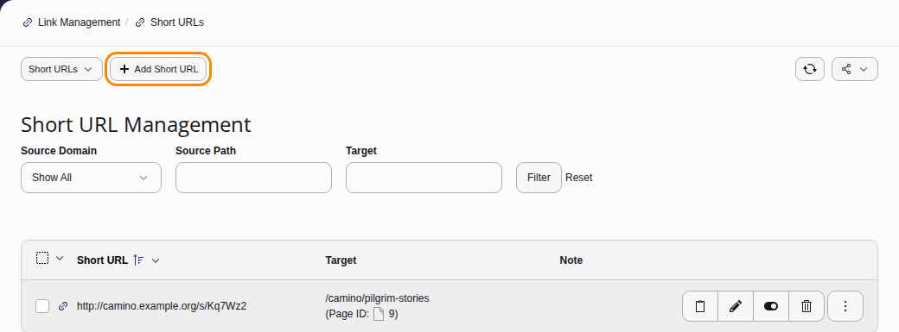
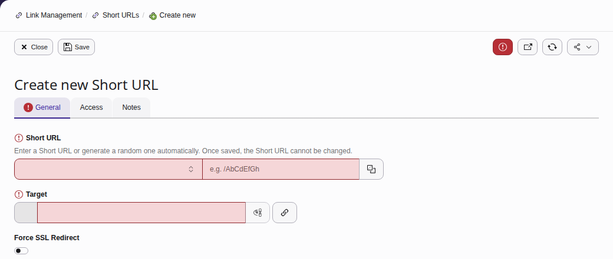
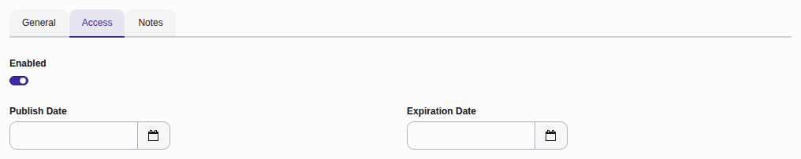
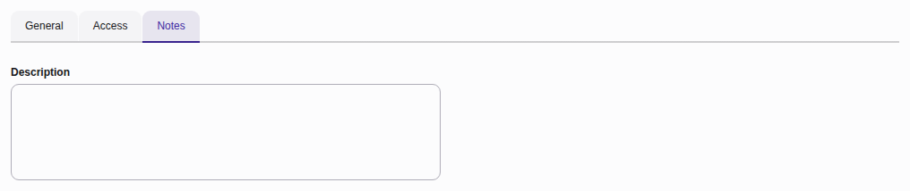
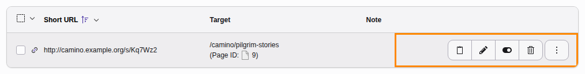

# Short URLs {#short-urls}

Short URLs are a way to share short or "tiny" URLs that point back to Pages in your TYPO3 installation.

Short URLs can point to files such as documents or redirect to external URLs.

## Scenario - shortening a long URL {#short-urls-scenario}

You want to share a link to your profile page found on your company website, however the URL itself is very long.

With Short URLs you can generate a short URL that you can share. They can also be
repurposed at a later date and can point to a completely new page or resource.

## Creating a short URL {#short-urls-creating}

From the Link Management module, select **Short URLs** followed by **Add Short URL** or **Create a new Short URL**.

### General tab {#short-urls-creating-general-tab}

**Short URL**: Select the domain you wish to link to the Short URL. If you only have one site in your installation, there will be only one option to choose from. Then use
the dice icon to generate a random string of text. Note, you can also manually set the Short URL - however this is not recommended.

**Target**: Specify which page in the **Page Tree** your Short URL will point to. It is also possible to link to Files stored in TYPO3 and also point to external URLs.

**Force SSL Redirect**: Force all requests to be served via https.

### Access tab {#short-urls-creating-access-tab}

**Enabled**: Toggle the Short URL on and off.

**Publish Date**: Set a publish date for when you want the Short URL to become active.

**Expiration Date**: Set an expiration date for when you want the Short URL to be no longer active.

### Notes tab {#short-urls-creating-notes-tab}

Add an internal note that other backend users can view.

## Edit an existing short URL {#short-urls-editing}

**Copy Short URL**: Copy the Short URL to clipboard.

**Edit Icon**: Edit the Short URL.

**Hide**: Enable or disable the Short URL without deleting it.

**Delete**: Delete the Short URL.

**View redirect**: View and test the Short URL.
