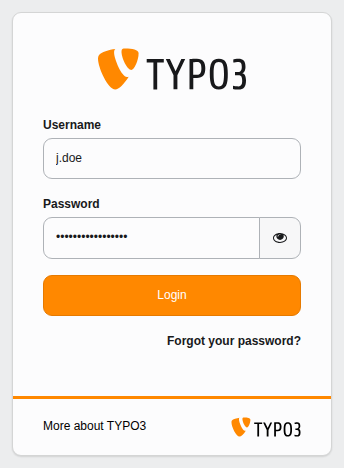
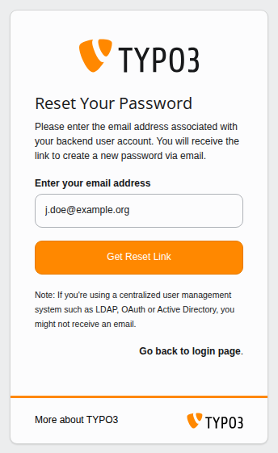
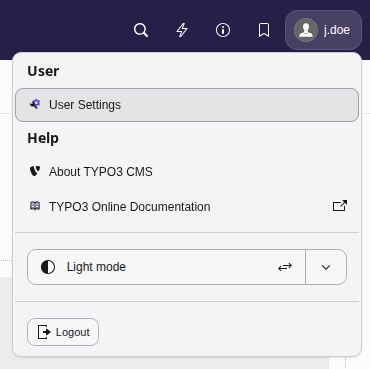

# Logging in to TYPO3 backend {#login}

If you are a TYPO3 editor, the backend is where you will most likely spend most
of your time. So let's start by logging in.

Navigate to  `https://example.org/typo3` in your browser. The
`/typo3` part can be changed, so if `/typo3` does not work, check
your project documentation or ask your administrator for the correct backend
URL.

If you are having problems logging in, have a look at the
troubleshooting tips.

-   [Troubleshooting: Forgotten password](https://docs.typo3.org/permalink/t3editors:troubleshooting-forgotten-password@main)
-   [Troubleshooting: You cannot log in](https://docs.typo3.org/permalink/t3editors:troubleshooting-you-cannot-log-in@main)
-   [Troubleshooting: Advice for administrators](https://docs.typo3.org/permalink/t3editors:troubleshooting-advice-for-administrators@main)
-   [Ending your session](https://docs.typo3.org/permalink/t3editors:ending-your-session-1@main)

## Troubleshooting: Forgotten password {#login-forgot-password}

1.  Click on **Forgot your password?**

    Go to the backend login page and select **Forgot your password?**.
1.  Enter your email address

    Use the same email address that you entered during registration.

    
1.  Open the email and follow the link

    If you haven't received the email, check your spam folder and
    double-check that the email address you entered is correct.
1.  Enter a new password

    Click on the password recovery link in the email and then enter a new
    password. Make sure you choose a password that fits your administrator's
    rules.

Things your **administrator** can check if this is not working correctly:

-   the [password reset feature](https://docs.typo3.org/m/typo3/reference-coreapi/main/en-us/ApiOverview/Backend/AccessControl/PasswordReset/Index.html#access-password-reset) is
    enabled
-   your backend account has a valid email address associated with it
-   the TYPO3 installation can send emails.

## Troubleshooting: You cannot log in {#login-troubleshooting}

Things you can check are:

-   JavaScript is enabled in your browser
-   your credentials are correct and valid
-   whether your IP address has changed (you will automatically be logged out).

### The backend is locked for maintenance {#login-troubleshooting-locked}

Your TYPO3 installation may be locked for maintenance and a message will appear
indicating that TYPO3 is in maintenance mode. Check with your administrator.

### Too many failed logins {#login-troubleshooting-failed-logins}

If you enter the wrong login credentials too many times,
you may be locked out of the backend. You
will see a message such as "The login is locked until
2026-08-31 10:58 due to too many failed login attempts from your IP address."

Wait till the time is up and then try logging in again.

### The login box reloads but no error message is displayed {#login-troubleshooting-login-reloads}

Login cookies could be incorrectly set. Try deleting your browser cookies.

## Troubleshooting: Advice for administrators {#login-troubleshooting-administrators}

See
[TYPO3 Getting Started, Troubleshooting common TYPO3 backend login problems](https://docs.typo3.org/m/typo3/tutorial-getting-started/main/en-us/Troubleshooting/BackendLogin.html#troubleshooting-backend-login).

## Ending your session {#ending-your-session}

When you have finished updating content or managing records, you should properly
end your session to secure your workspace. TYPO3 keeps your session open as
long as you are actively working, but explicitly logging out ensures that
unauthorized users cannot access your backend account from your device.

### How to log out {#logout-how-to}

To log out of the TYPO3 backend, have a look at the top bar:

1.  Click your name in the top-right corner.
1.  Select **Logout** from the menu.

You will be logged out straight away and taken back to the login page.
