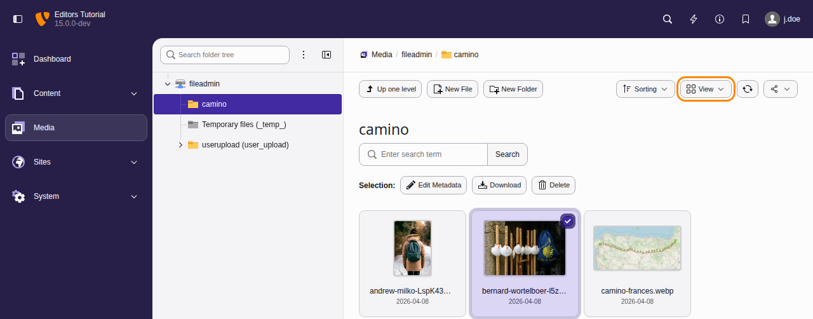
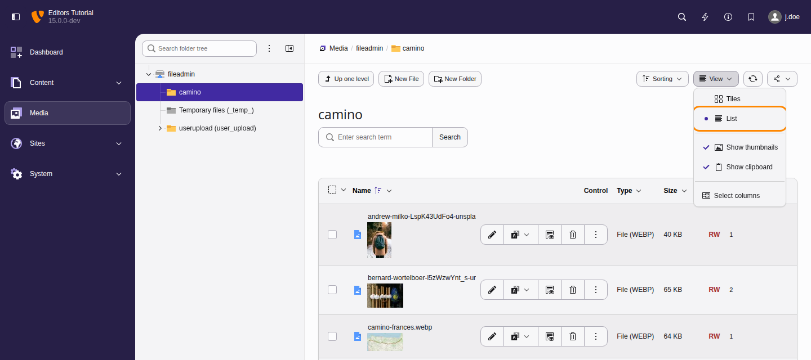
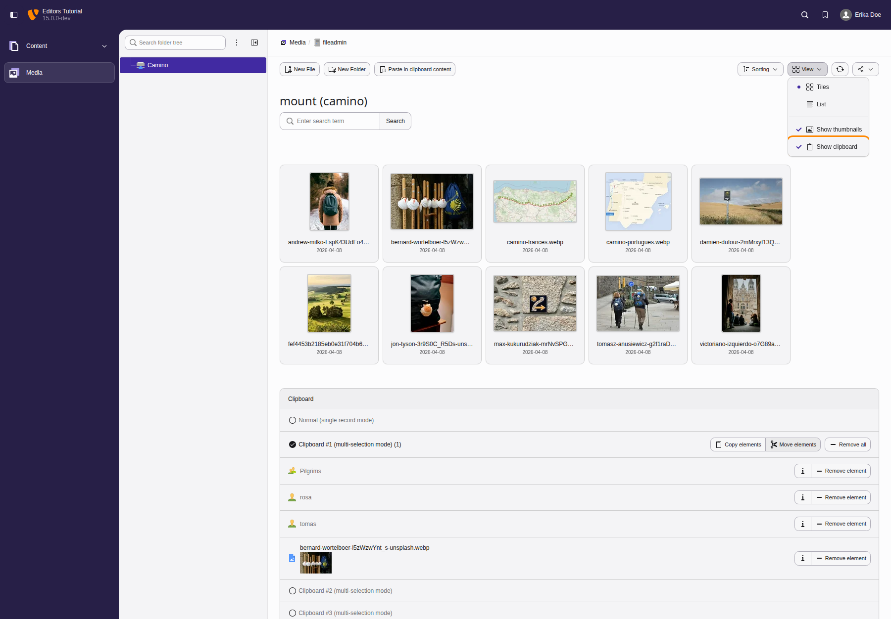
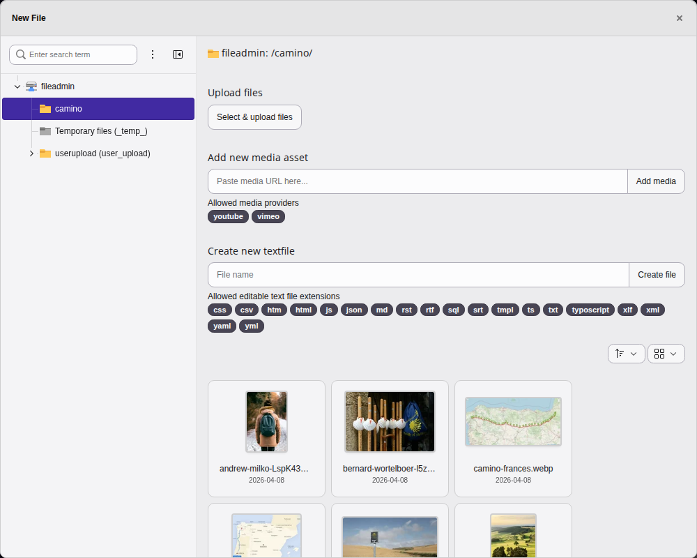
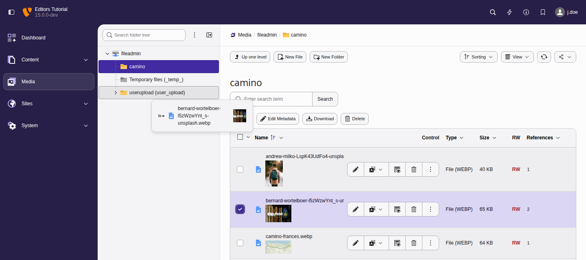

# Media upload and management in the TYPO3 backend {#media-module}

<!-- TODO: no Markdown rendering for "versionchanged" -->

This module has been renamed from Filelist to Media.

The **Media** module is where you can manage
all the media associated with your TYPO3 web site.

## Managing media in the TYPO3 CMS {#managing-files-in-typo}

Files including documents and images are managed in the
**Media** module. Similar to the **Content > Records**
module, it displays a navigation tree, which corresponds to the file
structure on the server, and a list of all files for the
selected directory.

For admin users, the folder displayed by default is called
"fileadmin/ (auto-generated)" and corresponds to the
`fileadmin/` folder located under the document root
folder on your web server.

Using these files inside content elements to display them
or link to them in your web site is covered in the
[images chapter](https://docs.typo3.org/permalink/t3editors:images@main).

> [!NOTE]
> There are extensions which make it possible to connect to remote
> storage pools (like a WebDAV server or an Amazon S3 account) and work
> with the files as if they were on the TYPO3 CMS server.

### File metadata {#file-metadata}

You can provide metadata for the file by clicking on the button that looka like
a pencil with the title text **Edit Metadata of this file**.

The metadata you provide can include (depending on the setup of the system
and the format of the file):

-   Text to be displayed to all users in some contexts (**Title**,
    **Description**)
-   Text for [accessibility](https://docs.typo3.org/permalink/t3editors:accessibility-writing-accessible-text-write-meaningful-text@main) such as the **alternative text**
    for an image or a **download name**
-   Data required due to copyright issues
-   Metadata attached to the uploaded file such as information about the
    camera used or the location

### Clipboard {#media-module-clipboard}

There is a clipboard just like in the **Content > Records** module.

The handling is the same as the description used in the [Advanced clipboard usage](https://docs.typo3.org/permalink/t3editors:advanced-clipboard-usage@main).

### Creating new folders {#creating-folders}

To create folders within the file storage, the button **Create Folder** opens a module dialog
with the familiar separation of tree and working frame. Left hand all available storages and folders
are displayed in tree structure. The folder selected here will act as the parent for the folders
to be created.
Folders are to be created one by one, the modal will remain open after operation to ease multiple
additions. Each new entry appears immediately in the folder tree and can be used as parent.

### Uploading new files {#uploading-files}

You can upload files to a given folder by using the context menu
or to the current directory by using the action icon in the docheader. Also, drag & drop
will initiate the upload. Drag any file into the main view to upload it to the
current folder, or select the `click, browse and choose files` option.

<!-- TODO: no Markdown rendering for "versionadded" -->

You can also paste files to upload them to the current folder. Copy one or more
files in the file manager of your computer, or copy image data such as a
screenshot, and press `Ctrl` \+ `V` in the Media module. On a Mac,
press `Cmd` \+ `V`. If a file with the same name already exists in the
folder, TYPO3 asks what to do with it, as it does for uploaded files. Pasting
into a field of the module, such as the search field, does not upload anything.

### Moving files and folders with drag and drop {#moving-files-drag-and-drop}

To move one or more files or folders to a different location, select them in
the working area and drag them onto the target folder in the navigation tree.
Releasing the mouse button over the target folder moves the selected items
there.

This is a quick alternative to using the [clipboard](https://docs.typo3.org/permalink/t3editors:advanced-clipboard-usage@main),
which remains useful when moving items across several steps or sessions.

## Next steps {#media-module-next-steps}

The next chapters cover configuration and administration tasks that
require special access privileges as described in [Access control in the
backend (users and groups)](https://docs.typo3.org/m/typo3/reference-coreapi/main/en-us/ApiOverview/Backend/AccessControl/Index.html#access).
