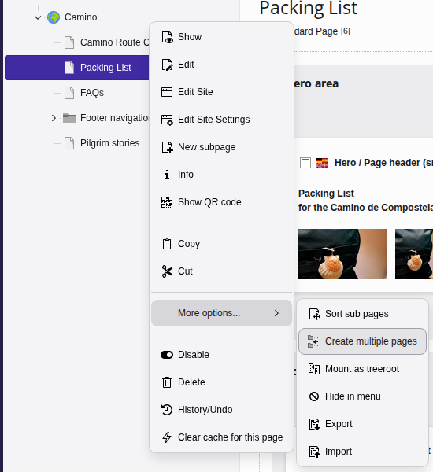
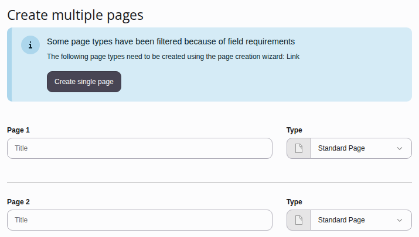
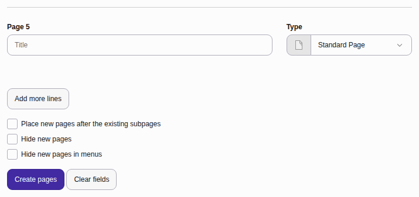

# Creating multiple pages {#pages-multiple}

If you need to build out a new section of your website quickly, you can create
many pages at once from the page tree.

[Watch this video on YouTube](https://www.youtube.com/watch?v=KmCButMH80g)

---

First click into the **Content > Layout** module in the left sidebar.

1.  **Open the bulk creator**:
    Right-click a "parent" page in the page tree and choose
    **More options > Create multiple pages** from the context menu.

    
1.  **Name your pages**: Enter a title and a page type for each page. Here
    we are just creating normal "standard" pages.

    
1.  **Expand your list**: Click **Add more lines** to add five more
    pages as needed.
1.  **Set page position and visibility** if necessary at the bottom of the
    screen:

    

    -   Positioning: Toggle
        **Place new pages after the existing subpages** to add
        the pages below any existing subpages. Leave it off to place them above.
    -   Visibility: Toggle **Hide new pages** or
        **Hide new pages in menus**.
1.  **Save your changes**: Click **Create pages**.

> [!TIP]
> **Hidden pages** are completely offline and inaccessible to visitors.
> **Hidden in menus** pages are online but will not appear in your site
> navigation. Visitors will still be able to visit your pages via URL.
