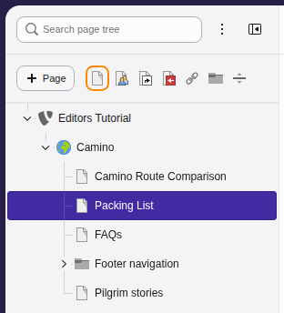
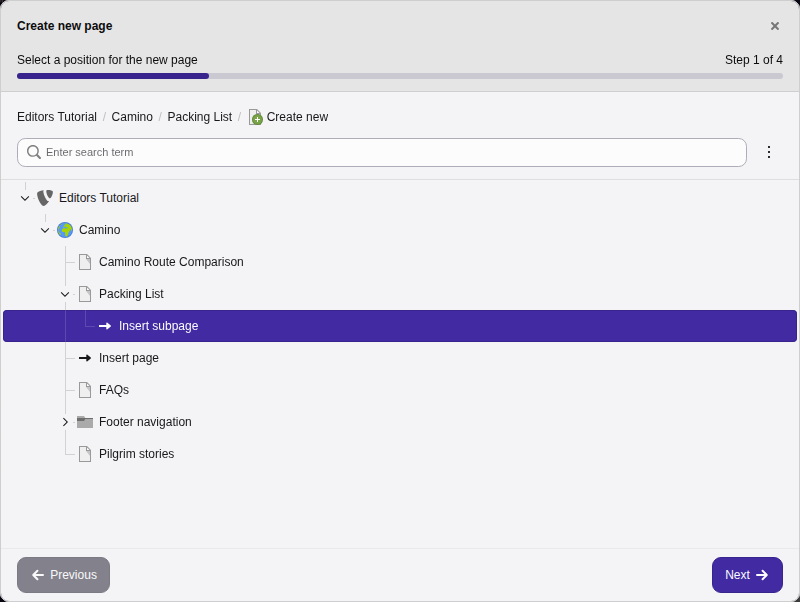
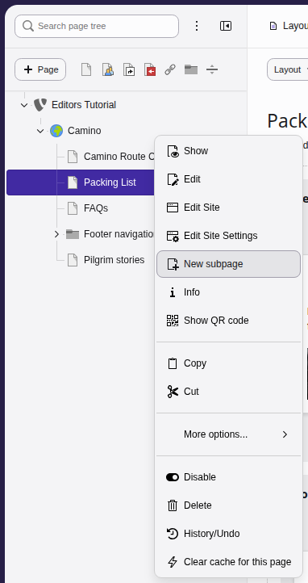

# Creating pages {#pages-creating}

Pages form the core structure of your website. Here you will learn how to
**create new pages on your site** using the **page tree**. New pages are
invisible in the frontend by default, so you will also learn how to make your
pages **visible**.

[Watch this video on YouTube](https://www.youtube.com/watch?v=UzHc1Z3vT6E)

---

There are two ways to create a new page. You can either **drag and drop from
icons** above the page tree or **right click on the tree** to bring up a context
menu. In both methods you select an existing page in the tree and your new page
is created underneath.

If you look at the icons above the page tree, you will see that you can create
different [types of pages](https://docs.typo3.org/permalink/t3editors:pages-types@main). Here we will just create a
**standard** web page.

First open
the **Content > Layout** module in the left sidebar. The
page tree is in the middle. Click around the page tree to see the selected page
displayed in the right pane.

## Method 1: Using drag and drop {#pages-creating-tree}

1.  Open the **page creator**: Click the **\+ Page** button at the top
    left of the page tree, or find the **row of icons** representing different
    types of pages.
1.  Position your page:

    -   If using **\+ Page**: Click on a location for your new page in
        the popup window. Select the page with the globe icon (**"root" page**)
        if you want to create another main page or select an existing page to
        create a **"child" page**. Then click on **Insert subpage**.
        Choose the standard page type.

    

    -   If dragging an icon: Grab the **Standard Page** icon and drag it
        into the page tree. You will see the same popup window.
1.  Name your page: Enter a **title** in the popup window.

## Method 2: Using the context menu {#pages-creating-context}

1.  Choose your location: right click on the "root" page (with the
    globe icon) to create another main page. Right click on an existing page if
    you want to create a "child" page.
1.  Select **New subpage** from the context menu.

    
1.  Enter the page title in the popup window.

## Making your new page visible in the frontend {#pages-visibility}

New pages are hidden from the public by default. There are 3 ways that you can
make your pages visible:

-   In the page tree: Right-click on the page and toggle the
    **Enable** switch from the context menu.
-   In the page properties of a page: Click on the page, click on
    **Edit page properties** at the top of the main pane, click on
    the **Access** tab, and toggle the **Page visible** switch
    (see below).
-   You can also publish while you are creating a page: Scroll to the bottom of
    the popup window and toggle the **Enable** switch.

