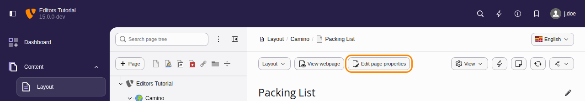
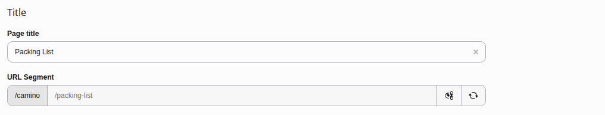
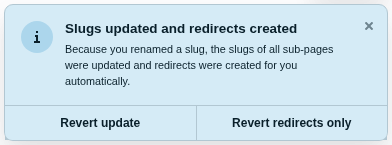
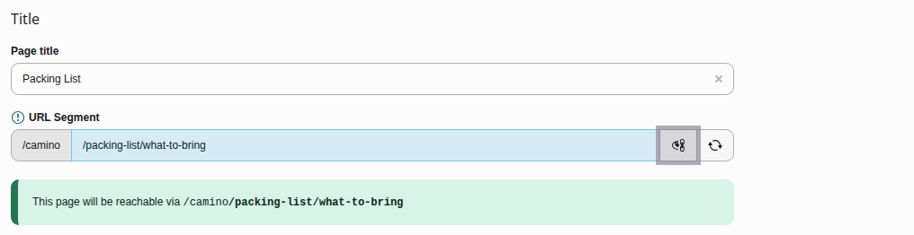
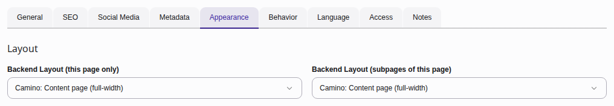
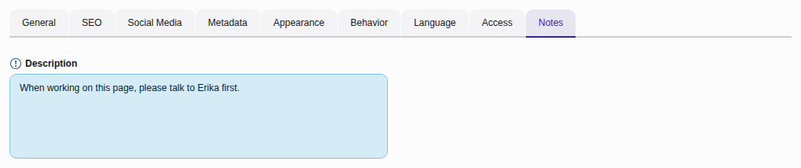

# Page properties {#pages-properties}

[Watch this video on YouTube](https://www.youtube.com/watch?v=AS9PhYqVtns)

---

To access the page properties, click on the **Edit page properties**
icon in the Docheader.

The page properties that are available depend on the page type, your user
permissions, and the configuration of the TYPO3 installation. The default
properties available for the *Standard* page type include:

-   [General](https://docs.typo3.org/permalink/t3editors:general@main)
-   [SEO](https://docs.typo3.org/permalink/t3editors:seo@main)
-   [Social media](https://docs.typo3.org/permalink/t3editors:social-media@main)
-   [Metadata](https://docs.typo3.org/permalink/t3editors:metadata@main)
-   [Appearance](https://docs.typo3.org/permalink/t3editors:appearance@main)
-   [Behaviour](https://docs.typo3.org/permalink/t3editors:behaviour@main)
-   [Resources](https://docs.typo3.org/permalink/t3editors:resources@main)
-   [Access](https://docs.typo3.org/permalink/t3editors:access@main)
-   [Categories](https://docs.typo3.org/permalink/t3editors:categories@main)
-   [Notes](https://docs.typo3.org/permalink/t3editors:notes@main)
-   [YouTube video "Page Properties" (TYPO3 11.5)](https://docs.typo3.org/permalink/t3editors:youtube-video-page-properties-typo3-11-5@main)

## General {#pages-properties-general}

This tab contains general information about the page. You
can change the **Page Type**, and edit titles for the page and the URL.

The following fields are of interest:

-   [Page type](https://docs.typo3.org/permalink/t3editors:page-type@main)
-   [Page title / alternative navigation title](https://docs.typo3.org/permalink/t3editors:page-title-alternative-navigation-title@main)
-   [URL segment](https://docs.typo3.org/permalink/t3editors:url-segment@main)

### Page type {#pages-properties-url-type}

The page types listed here vary with how the site package is defined and your
user rights.

See chapter [Page types](https://docs.typo3.org/permalink/t3editors:pages-types@main)
for details.

### Page title / alternative navigation title {#pages-properties-titles}

The **Page Title** is used as label in menus and in the `<title>` tag in
the HTML header. It is also used to generate the URL Segment.

When you specify an **Alternative Navigation Title** this title is used
as label in the menus while other usages of the "Page Title" stay unchanged.

The "Subtitle" is only used if your site package configured it to be output
somewhere.

### URL segment {#pages-properties-url-segment}

The "URL Segment", sometimes also called "Slug" is used to calculate the URL
at which your page is available. Usually it is filled out automatically.

If the "Redirects" system extension is installed, an automatic redirect from
the old to the new URL is created:

It is also possible to edit the URL segment by clicking the "Toggle" button.
You can then enter a different URL segment:

## SEO {#pages-properties-seo}

This tab is used for search engine optimization. It uses the cs_seo system
extension. See section
[SEO Tab](https://docs.typo3.org/permalink/t3editors:seo-page-properties-seo@main)
in chapter
[Search engine optimization (SEO) for TYPO3 editors](https://docs.typo3.org/permalink/t3editors:seo@main)
for more information.

## Social media {#pages-properties-social-media}

The fields on this tab are used to enrich social media snippets for the URL of
the page. See section
[Social media tab](https://docs.typo3.org/permalink/t3editors:seo-page-properties-social-media@main)
in chapter
[Search engine optimization (SEO) for TYPO3 editors](https://docs.typo3.org/permalink/t3editors:seo@main)
for more information.

## Metadata {#pages-properties-metadata}

The fields available on this tab depend on how your site is configured. How the
data is used by the frontend depends on TypoScript which depends on your site
configuration.

Typically, you might see the **Abstract** field, and editorial
details like **Author Name** and **Last Update**.

## Appearance {#pages-properties-appearance}

This tab contains properties that influence how the page is rendered. By default
it contains settings for the page layout, which influences the pages appearance
in both the frontend and the Page Module in the backend. Sometimes a site package
defines additional fields in this tab regarding appearance. Refer to the
documentation of your site package or ask your integrator.

### Page layout / Backend Layout {#pages-properties-page-layout}

Backend Layouts influence the general structure of a page not only in the
backend but also in the frontend. A Backend Layout influences which content
areas are available in the Page Module to
[Manage content](https://docs.typo3.org/permalink/t3editors:content-working@main)
in them. A Backend Layout is usually bound to its own frontend template which
influences the appearance in the frontend.

## Behaviour {#pages-properties-behaviour}

In this tab there is usually not much to do for an editor. Advanced editors can
use it to exclude certain pages from the search.

## Resources {#pages-properties-resources}

This tab lets you link media files to the current page.
How those files are handled depends on your frontend rendering
configuration.

## Access {#pages-properties-accesss}

This tab lets you control the visibility of the page.

For more information, see [Elements visibility](https://docs.typo3.org/permalink/t3editors:visibility@main).

## Categories {#pages-properties-categories}

How categories for pages are used during rendering is up to the site package.
By default they do not do anything.

## Notes {#pages-properties-notes}

Use this tab for your own editorial notes and internal comments, such as
reminders or to-do lists.

## YouTube video "Page Properties" (TYPO3 11.5) {#pages-properties-video}

[Watch this video on YouTube](https://www.youtube.com/watch?v=dtRKsxzjKj0)
