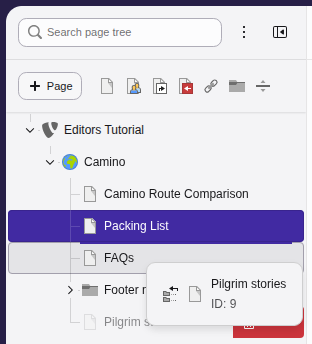
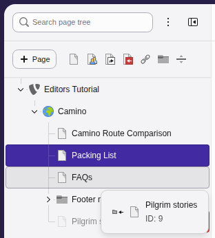
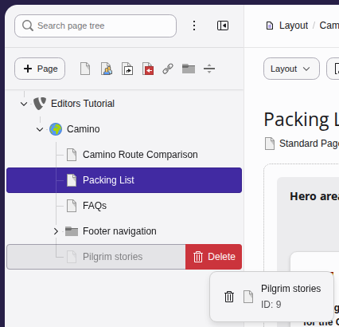
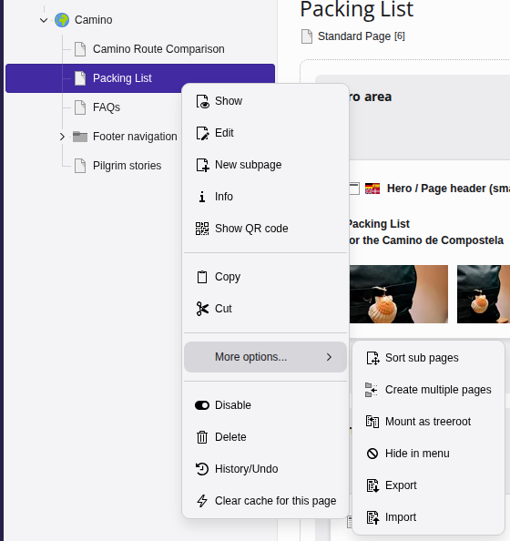
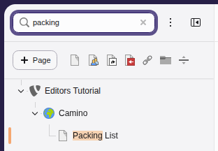

# Working with pages {#pages-drag-drop}

You can organize pages in your website using the **page tree**.

[Watch this video on YouTube](https://www.youtube.com/watch?v=cfASKN-WbaQ)

---

First click on
**Content > Layout** in the backend sidebar to display the page tree in
the middle pane.

## Moving pages {#move-pages}

You can change your site hierarchy or reorder pages by dragging-and-dropping
inside the page tree.

1.  **Locate the page** you want to move within the page tree.
1.  **Click and drag** the page to its new position. A horizontal line will
    appear to preview where the page will land.

    
1.  **To nest a page** (making it a "child" of an existing page), drag it
    directly over the target page until a gray outlined background appears.

    
1.  **Release your mouse.** A confirmation message will prompt you to choose
    between copying or moving.
1.  Select **Move this item**.

> [!TIP]
> To copy a page instead of moving it, follow the exact same steps but select
> **Copy** from the confirmation prompt.

## Deleting pages {#delete-pages}

To remove a page entirely, click and drag the page to the right. You will see
the **Delete** action.

## Context menu actions {#pages-working-with-context-menu}

Right click on any page in the page tree to bring up the context menu and see
the many editing shortcuts and page functions.

## Filtering the page tree {#filter-the-page-tree}

Use the search tool at the top of the page tree to quickly
isolate specific pages by keyword, page ID number, or frontend page URL.
Separate multiple keywords, IDs, or URLs with a comma.

Filtering pages in the page tree
