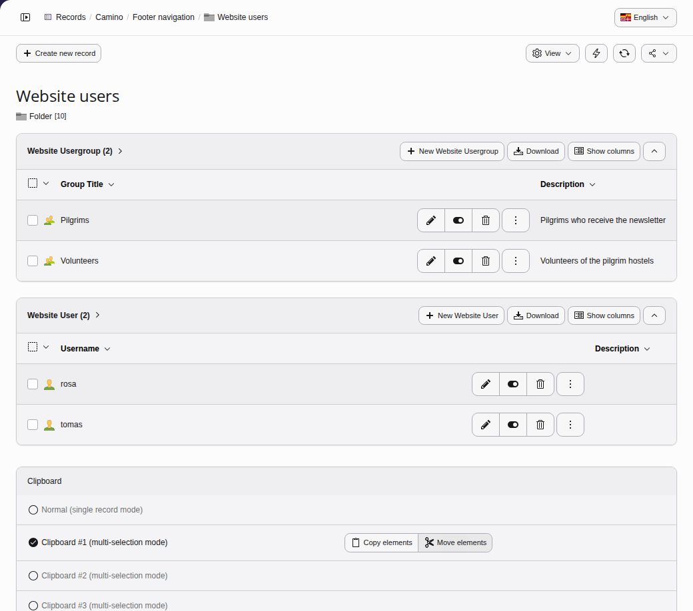
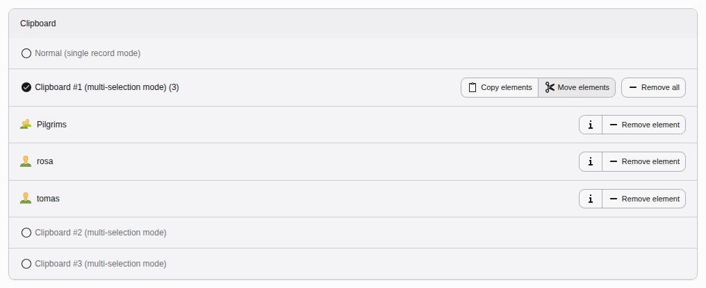

# Using the clipboard to copy or move multiple records at once {#the-numeric-clipboard-pads-managing-many-elements}

If the clipboard is not yet enabled, display it via the "View" drop down in the
header of the **Content > Records** module. Then choose one of the clipboards, for example
"Clipboard #1".

As soon as one or more records are checked, new buttons will appear at the top of the list:

1.  **Edit** all selected items at once
1.  **Transfer to Clipboard** all selected items at once
1.  **Remove from Clipboard** all selected items at once
1.  **Delete** all selected items at once

Now check several boxes and click the **Transfer to Clipboard** button.
Your clipboard should look like this:

The button **Move Elements** is selected by default. Select the button
**Copy Elements** instead. The selected elements will now be copied
and the current page will remain unchanged.

Move to another page and click the "Paste in clipboard content" button:

A confirmation dialog appears. If you click ok, the chosen records are moved or
copied, depending on the mode selected in the Clipboard on the bottom of the
**Content > Records** module.
