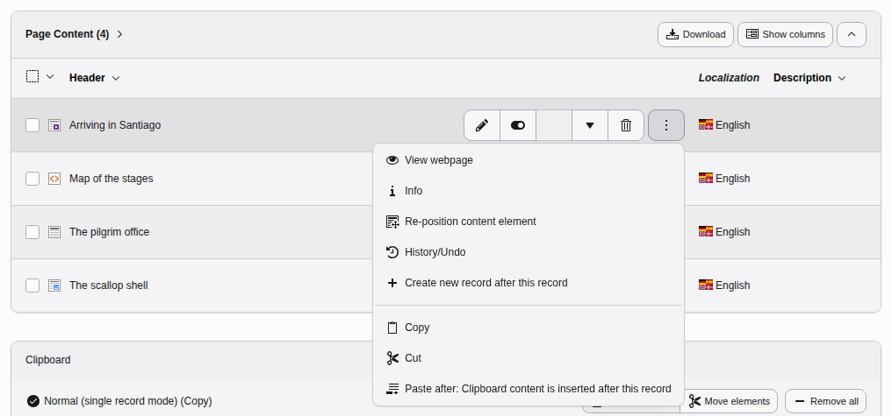
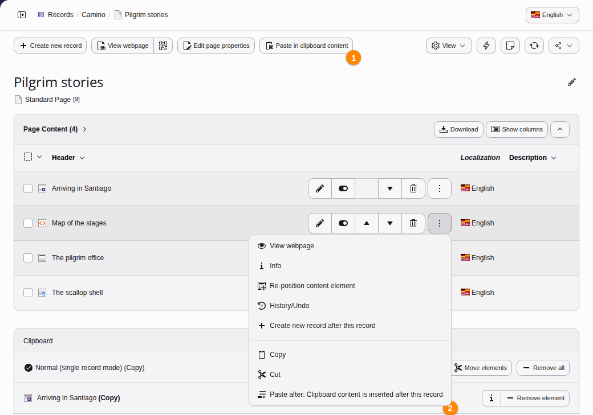
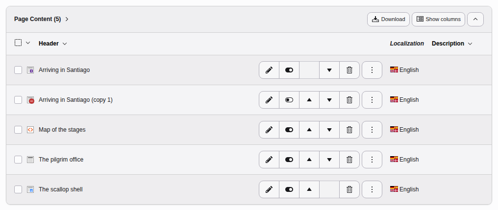
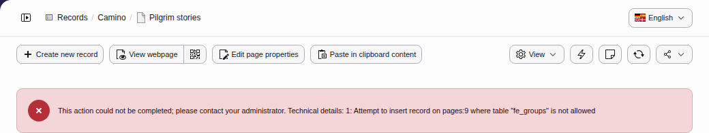
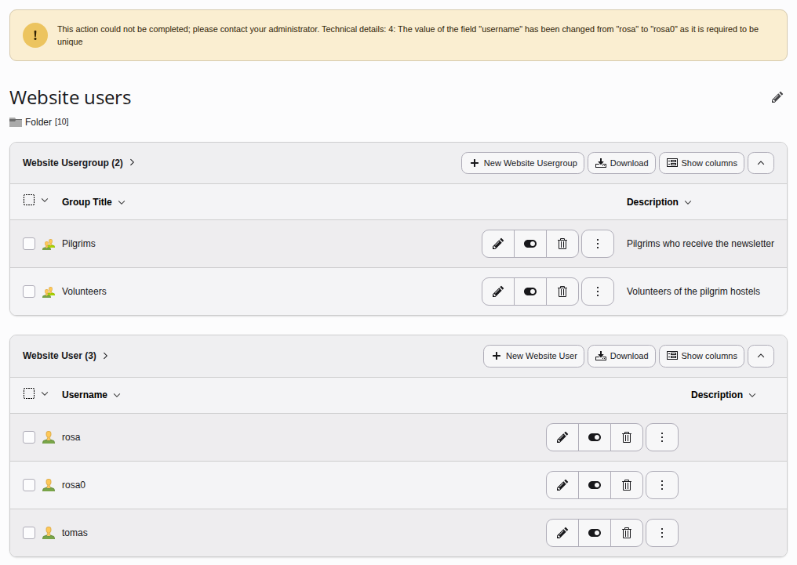

# Copy and paste database record {#list-copy-paste}

You can copy and paste records in the **Content > Records** module using the context
menu and then choose "copy" (or cut if you want to move the record instead).

> [!TIP]
> If you want to copy or move several database records at once, use the
> [clipboard](https://docs.typo3.org/permalink/t3editors:clipboard@main).

**Table of content**

-   [How to copy and paste in the Records module](https://docs.typo3.org/permalink/t3editors:how-to-copy-and-paste-in-the-records-module@main)
-   [Trouble shooting during copy and paste](https://docs.typo3.org/permalink/t3editors:trouble-shooting-during-copy-and-paste@main)

## How to copy and paste in the Records module {#list-copy-paste-howto}

Open the context menu by clicking the three dots button or the icon to the
left of the record. Copy or cut the database record.

To paste the copied record you have several options:

## Trouble shooting during copy and paste {#list-copy-paste-trouble}

If you see any error messages not listed here, note the date and time, error
message and what you have been doing. Send the information to your site
administrator.

### Why is the header appended with (copy 1)? {#list-copy-paste-copy-1}

By default the title of the pasted record is post fixed with "(copy x)" and the
new record is marked as hidden and not displayed in the frontend.

This default behaviour of titles being prefixed can make working with copy and
paste tedious and advanced editors often prefer that the integrator of the site
turns of this behaviour. They can use the setting
[disablePrependAtCopy](https://docs.typo3.org/m/typo3/reference-typoscript/main/en-us/PageTsconfig/TceMain.html#confval-tcemain-disableprependatcopy) to
disable this.

### Attempt to insert record on a page that can't store record type {#list-copy-paste-record-on-page}

Some record types, for example frontend user records or category records may
only be created in pages of type "folder". If you try to insert such a record
on a plain page, an error message will be displayed:

The record was not pasted in this case. Use the page tree to switch to a folder,
for example the folder "Website users" and click the "Paste in clipboard
content" there.

### The value of the field "username" has been changed as it is required to be unique {#list-copy-paste-unique}

Some fields need to be unique across the complete TYPO3 installation, for example
a user name or identifier.

If you try to copy & paste such a record, the affected fields are automatically
renamed by appending a number.

The record has been pasted but renamed. Edit the new record and replace the
field with a unique value.
