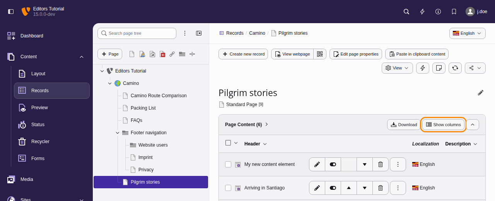
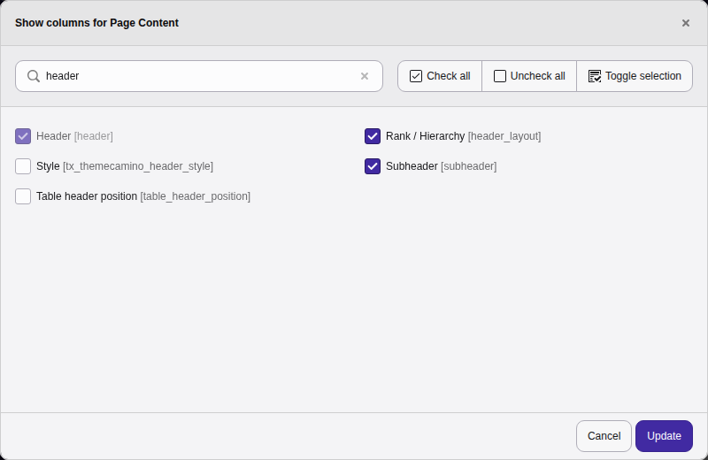
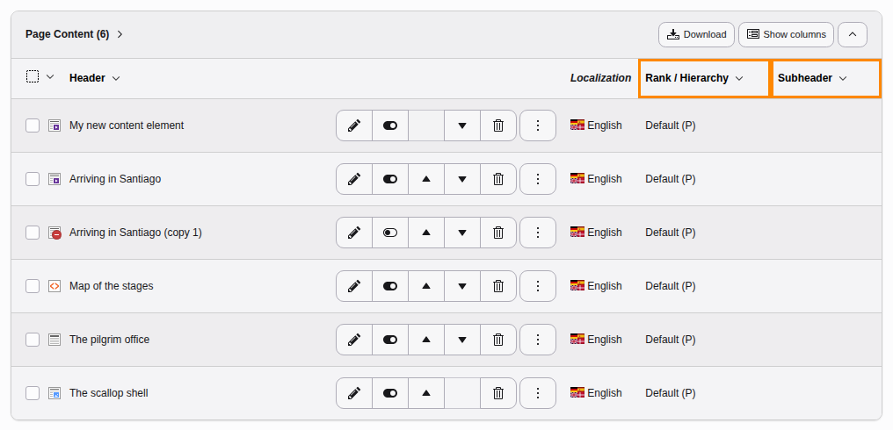
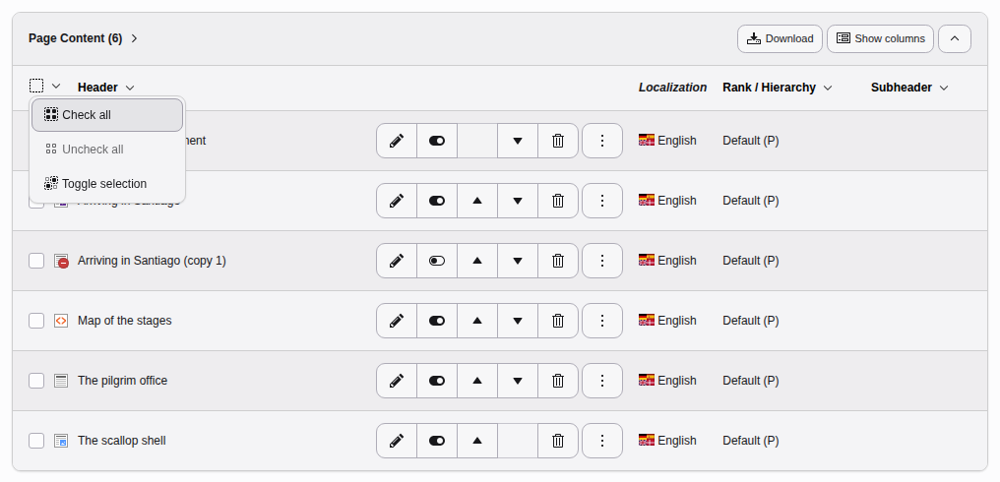
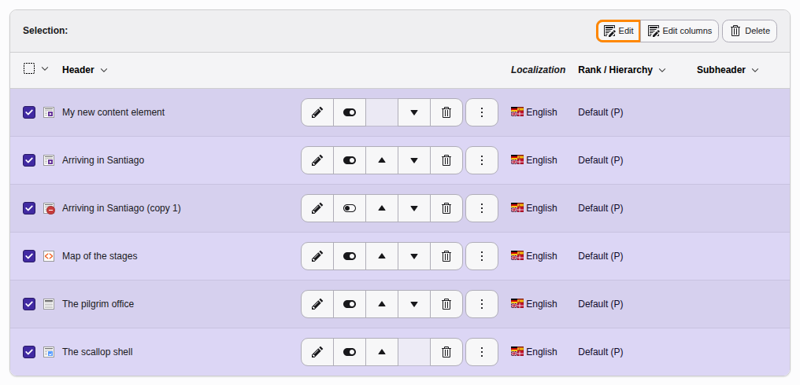
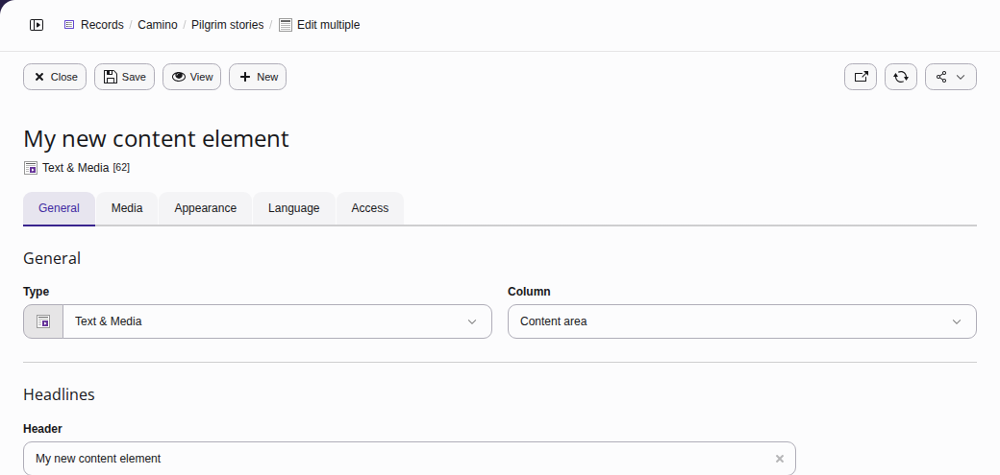
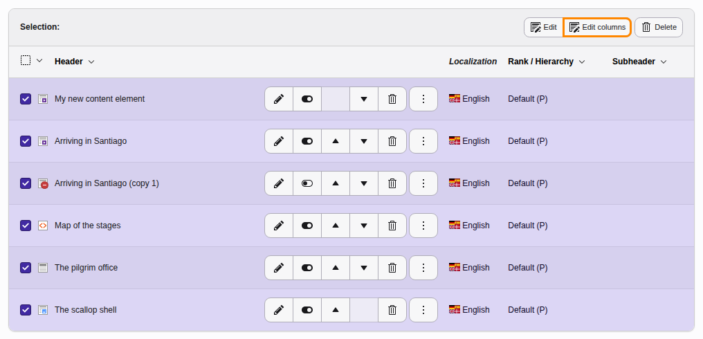
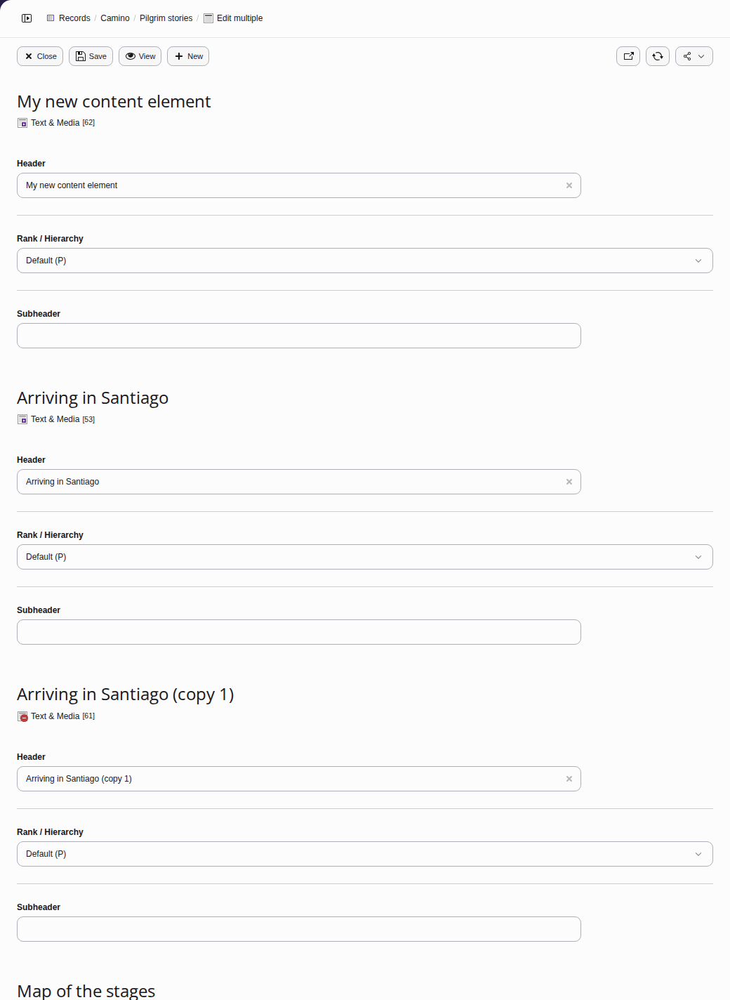
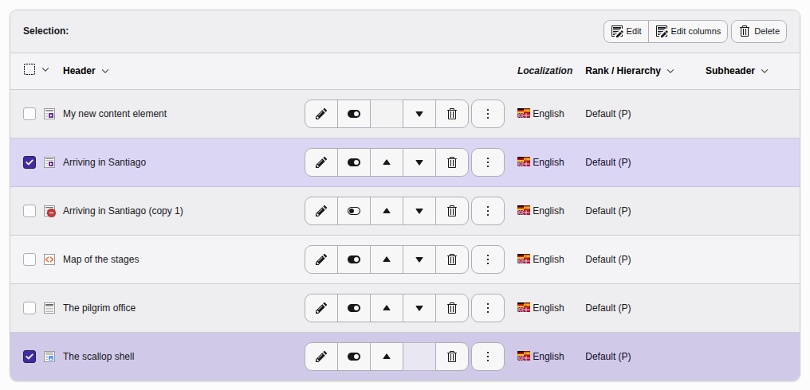

# Mass editing {#mass-editing}

Use the **Content > Records** module to bulk edit multiple content
elements on a page at the same time.

Select the page you want to edit in the page tree in the middle pane (here
"Pilgrim stories"). The content elements on the page are displayed in the
right-hand pane under Page Content.

Select the fields you want to edit by clicking on the **Show
Columns** button ("Columns" refers to content element fields). Here we
select **Rank / Hierarchy** and **Subheader**. Click on the
**Update** button.

The added fields now appear on the right:

## Bulk edit all content elements on a page {#selective-editing-fields}

First select all the content elements on the page by clicking in the
dropdown box on the left and selecting **Check all**
(**Toggle selection** reverses the selection).

You can now choose either the **Edit** button or the
**Edit columns** button.

Click on the **Edit** button to display a screen to **edit all fields**
of the selected content elements.

The screen will look as follows, with the content elements displayed one
after the other. Click on **Save** after you have finished
editing.

Or **edit only the displayed fields you have selected** by clicking on the
**Edit columns** button:

The screen will look as follows (here with the fields Header, Rank / Hierarchy,
and Subheader). Click on **Save** after you have finished editing.

## Edit selected content elements {#selective-editing}

Select the content elements which you would like to edit (here "Arriving in
Santiago" and "The scallop shell"):

Then follow the instructions for bulk editing all the fields
(**Edit** button) or only the displayed fields
(**Edit columns** button)
[in the previous section](https://docs.typo3.org/permalink/t3editors:selective-editing-fields-choose@main).
