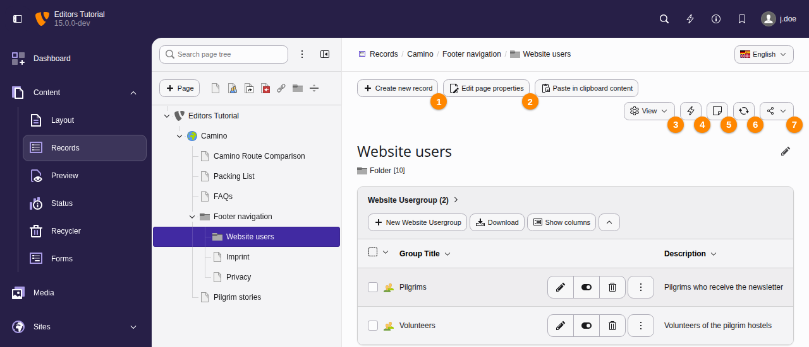
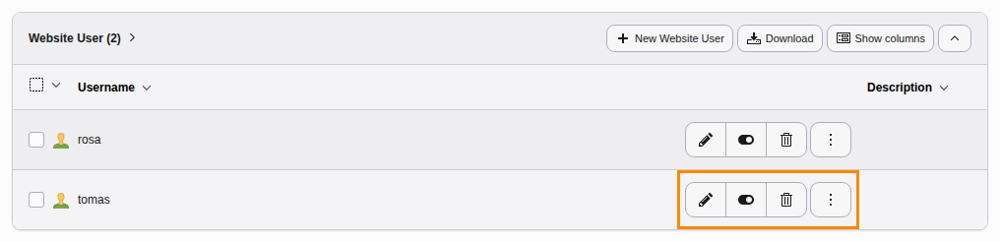
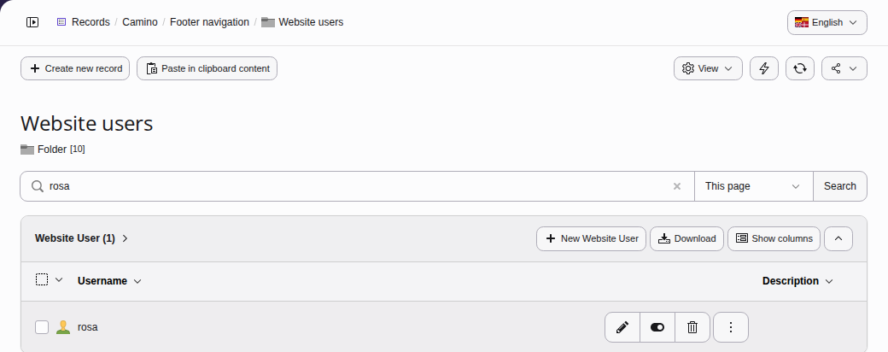
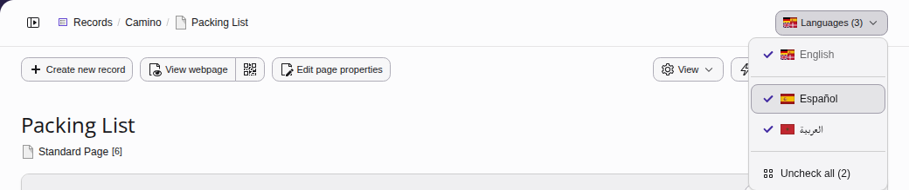
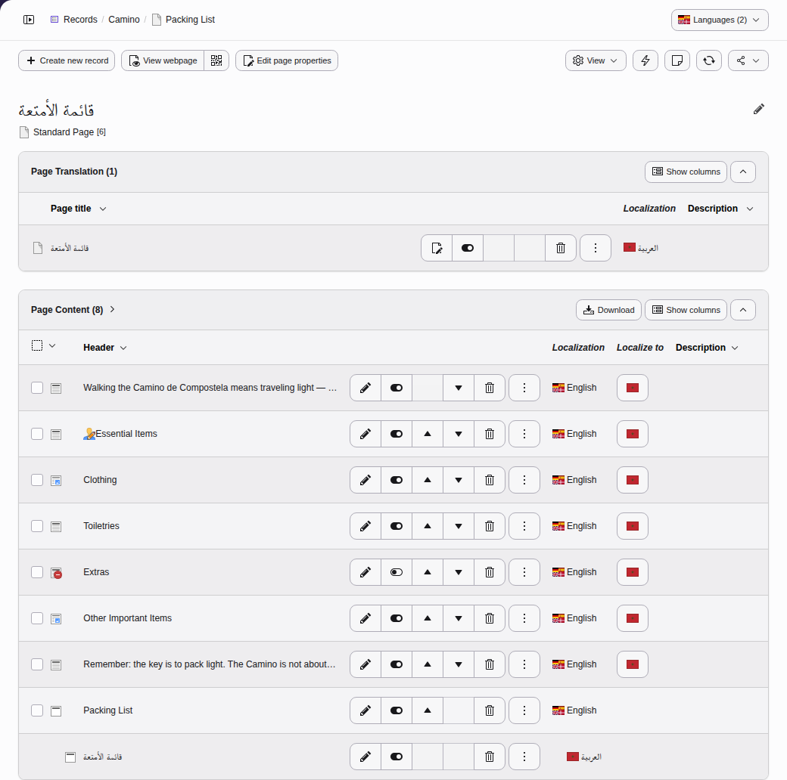

# Using the Records module {#using-the-list-module-effectively}

<!-- TODO: no Markdown rendering for "versionchanged" -->

This module has been renamed from Web > List to
Content > Records.

The **Content > Records** module allows you to browse through pages and folders
in your site and view the records that
are stored there. You can also create and edit records.

Select the **Content > Records** module and choose a page or storage folder.

**Table of Contents**

-   [The Records module header](https://docs.typo3.org/permalink/t3editors:the-records-module-header@main)
-   [Editing a record of a certain type](https://docs.typo3.org/permalink/t3editors:editing-a-record-of-a-certain-type@main)
-   [Finding a record in a long list](https://docs.typo3.org/permalink/t3editors:finding-a-record-in-a-long-list@main)
-   [Showing the records of certain languages](https://docs.typo3.org/permalink/t3editors:showing-the-records-of-certain-languages@main)

## The Records module header {#list-module-header}

The list view displays a list of records stored on the
current page, grouped by type. The **Content > Records** module is commonly used for records
that have no dedicated backend module, for example website users and groups.

The list view has action icons in the **module header** including:

1.  **Create new record** (a wizard appears to let you choose which type)
1.  **Edit page properties** of the current page
1.  **View** or hide search or [the clipboard](https://docs.typo3.org/permalink/t3editors:clipboard@main)
1.  **Clear the cache** of the current page
1.  **Create internal note**
1.  **Refresh** the **Content > Records** module
1.  **Share** Copy an URL to this page or bookmark it for quick access

> [!TIP]
> Use the **Create new record** button if you want to create a record of
> a type that does not yet have items on the current page.

## Editing a record of a certain type {#list-module-record-type}

If there are already database records stored on the current page, each record
type features its own action buttons for available actions:

In this example the first button can be used to edit the user group, the second
button to hide or unhide it, the third button to delete it. The button with the
three dots offers additional options.

> [!TIP]
> You can also edit a database record by clicking on its title.

## Finding a record in a long list {#list-module-record-search}

If there are a large number of records you can use the search box to search for
a record containing a certain word.

It is also possible to include subpages of the current page by choosing the
number of levels (for performance reasons) in which to search.

If you do not know on which page the record could be found you can also
use the [Backend search](https://docs.typo3.org/permalink/t3editors:backend-search@main).

The search can be opened by selecting the magnifying glass in the top right
corner of the toolbar or by pressing the `Cmd + K`
keystroke on MacOS or the `Ctrl + K` keystroke on Windows and Linux
systems.

## Showing the records of certain languages {#list-module-languages}

<!-- TODO: no Markdown rendering for "versionadded" -->

On a page with translations, the **Content > Records** module lists
the records of the languages that you choose in its language menu. The button
of the menu, at the top right of the module, shows how many languages the
record list shows.

1.  Open the language menu. The languages with a check mark are the ones
    that the record list shows.
1.  Click a language to show or hide its records.
1.  Click **Check all** to show the records of all languages, or
    **Uncheck all** to show the default language only.

The records of the default language always stay in the record list, as well as
records that apply to all languages. Their translations show below them.

TYPO3 remembers the languages that you have chosen for each page. The
**Content > Layout** module shows the same languages on that page.

On a page without a translation, the language menu offers to create one under
**Create new translation**, see
[Create the page translation](https://docs.typo3.org/permalink/t3editors:languages-create-page-translation@main).
