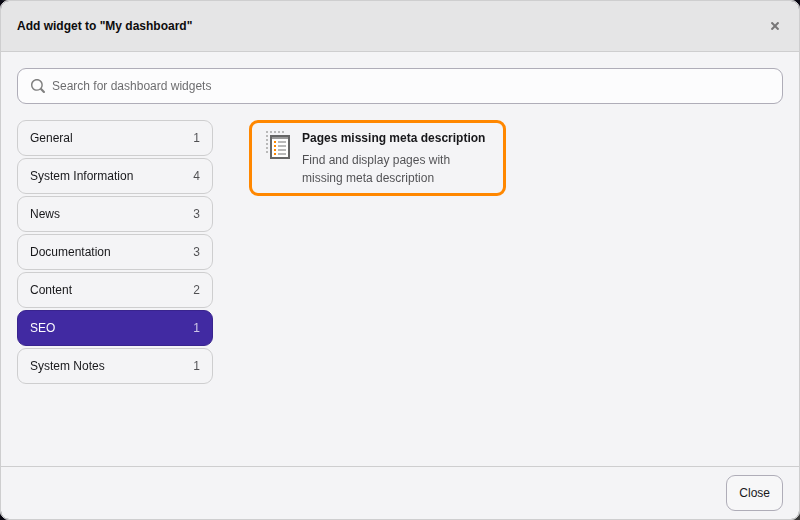
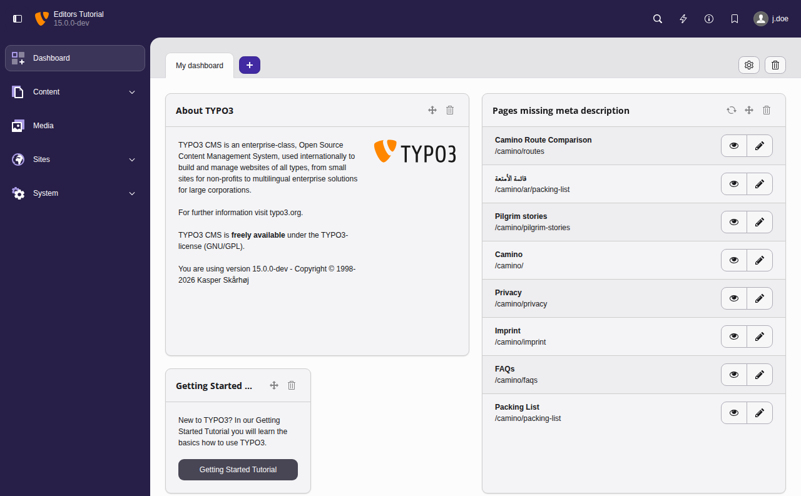
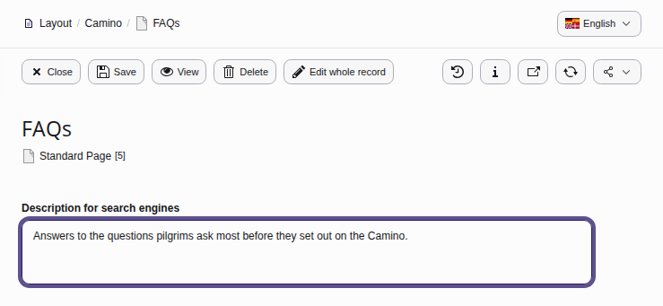

# Dashboard widgets for search engine optimization (SEO) in TYPO3 {#dashboard-widgets}

The following dashboard widgets are available to editors if your integrator
installed the system extension [`typo3/cms-seo`](https://packagist.org/packages/typo3/cms-seo) and if you have been
granted the permissions to use them.

## "Missing Meta Description" widget {#dashboard-widgets-missing-description}

To make it more convenient for TYPO3 editors to optimize their website for search
engines, [`typo3/cms-seo`](https://packagist.org/packages/typo3/cms-seo) offers a dashboard widget that shows pages without
a meta description.

The description field is important for SEO purposes. This field is used to
instruct search engines to use this text to show as a teaser of your page in
the search result snippets. With this description, you can give the user a
clear overview of the topic of this page:

### Adding the "Missing Meta Description" widget to your personal Dashboard {#dashboard-widgets-missing-description-add}

If you have the access rights to the Dashboard module and are granted access to
the "Missing Meta Description" widget you can add it yourself to your Dashboard:

1.  Open the Dashboard module
1.  Click on the plus button to add a widget
1.  Go to category "SEO"
1.  Choose widget "Pages missing meta description"

### Using the "Missing Meta Description" widget to improve SEO results {#dashboard-widgets-missing-description-use}

This widget lists pages that are missing a description in their meta data:

You can now click on the pencil icon to add a description to the page:

