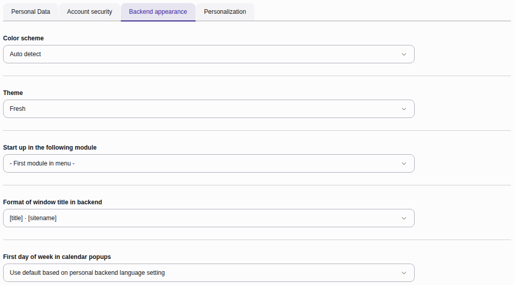
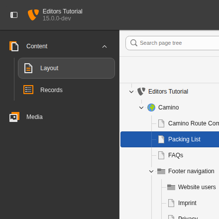
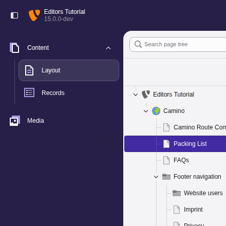
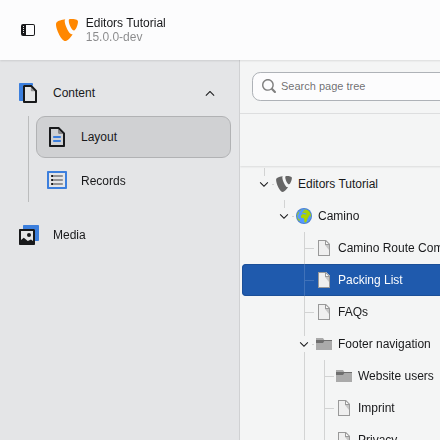

# Change how the TYPO3 backend looks and behaves {#user-settings-backend-appearance}

Customize the look, feel, and navigation behavior of your backend. These
settings only change your own backend, not what other editors see.

-   **Color scheme:** Choose **Light mode**, **Dark mode** or
    **Auto detect**, which follows the setting of your operating
    system.
-   **Theme:** Choose one of the [backend themes](https://docs.typo3.org/permalink/t3editors:user-settings-backend-themes@main).
-   **Start up in the following module:** Select the module you see when you
    log into the backend, for example **Dashboard**,
    **Content > Layout** or **Media**.
-   **Format of window title in backend:** Set the text of the browser tab,
    for example whether the page title or the site name comes first.
-   **First day of week in calendar popups:** Set whether calendars in date
    pickers start on Sunday or Monday.

## Backend themes {#user-settings-backend-themes}

A theme changes the look of the backend. It does not change where things
are or what you can do.

