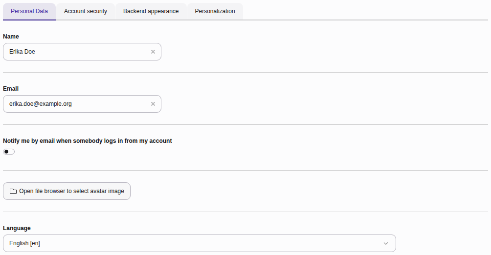
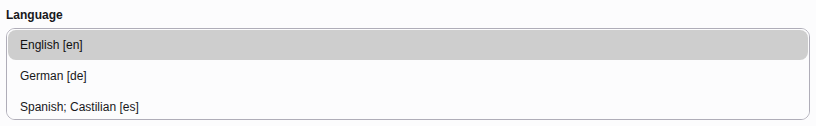

# Change your name, email address and backend language {#user-settings-personal-data}

This tab holds your profile details. Your username cannot be changed.

-   **Name:** Your full name, displayed in the backend.
-   **Email:** The address used for system notifications and password resets.
-   **Notify me by email when somebody logs in from my account:** Sends you an
    email whenever somebody logs in with your account.
-   **Avatar:** The picture shown next to your name in the topbar. Use
    **Open file browser to select avatar image** to choose one.
-   **Language:** The language of the backend labels and menus.

> [!NOTE]
> You can only select a language whose language pack is installed. If the
> language you need is missing, ask your administrator to install it.
